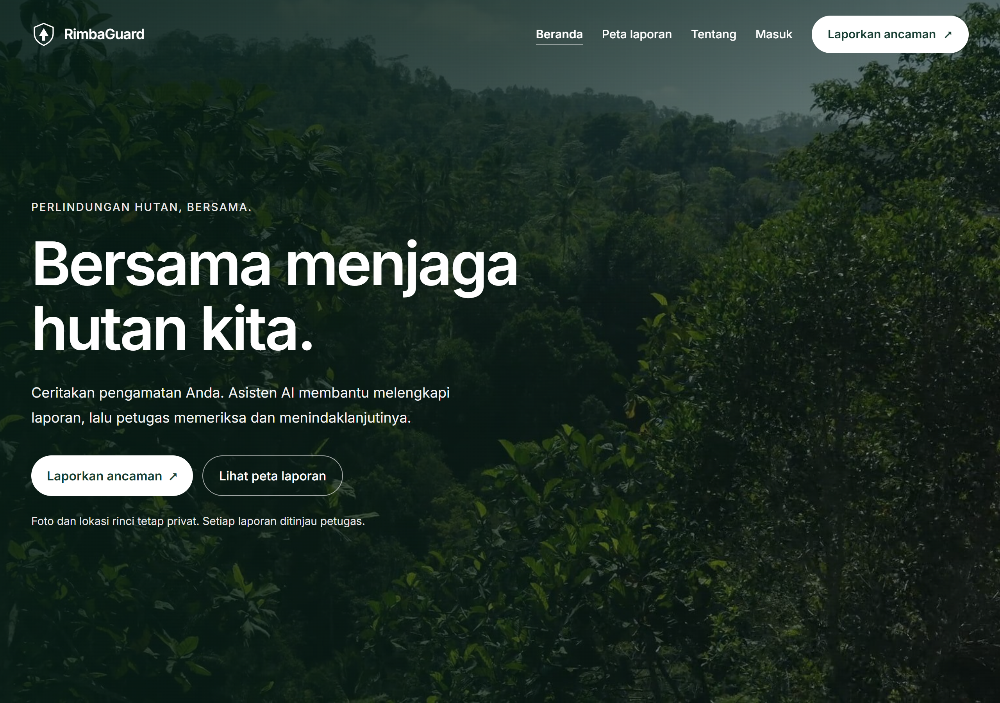
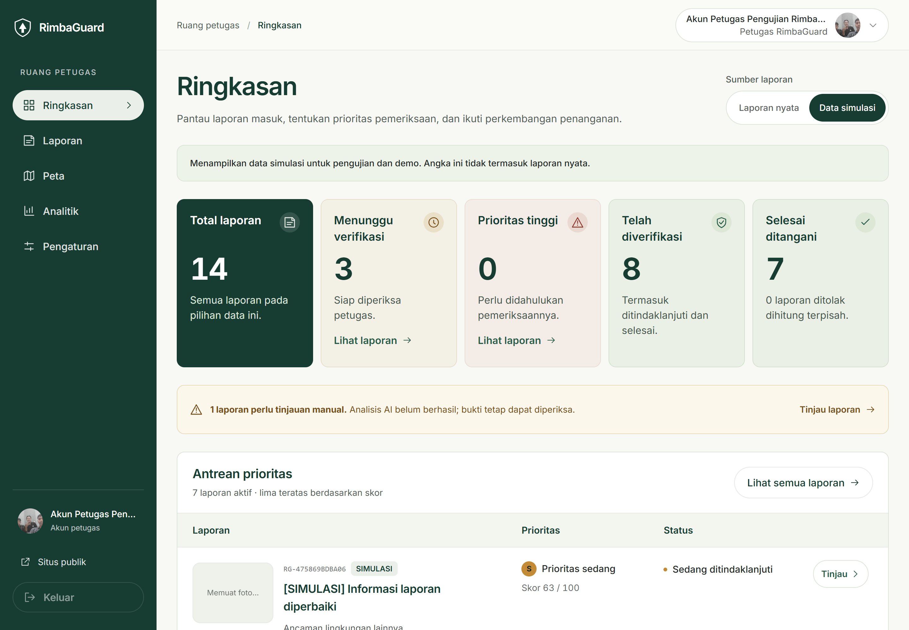

# RimbaGuard

**Asisten pelaporan dan prioritas pemeriksaan ancaman hutan.** Warga melapor dengan bantuan AI, skor prioritas yang transparan mengurutkan pemeriksaan, dan petugas memverifikasi serta menindaklanjuti. Aplikasi berbahasa Indonesia.

| | |
|---|---|
| **Website live** | [ifs24044-rimbaguard.s1if.cloud](https://ifs24044-rimbaguard.s1if.cloud) |
| **Video demo** | [youtu.be/J-vmfoXlex8](https://youtu.be/J-vmfoXlex8) |
| **Proposal** | [ITRUSH26_semogabisamagang_RimbaGuard.pdf](docs/ITRUSH26_semogabisamagang_RimbaGuard.pdf) |
| **Akun demo** | Akun pelapor dan petugas tercantum pada Lampiran D proposal yang dikumpulkan ke panitia |
| **Kompetisi** | Web Development IT RUSH 2026 · Subtema Lingkungan dan Konservasi |
| **Tim** | semogabisamagang · Institut Teknologi Del |



## Masalah dan solusi

Kementerian Kehutanan mencatat deforestasi netto 175.400 hektare sepanjang 2024, dan kebakaran hutan dan lahan menghanguskan sekitar 359.000 hektare pada 2025 ([sumber](https://lestari.kompas.com/read/2025/03/21/180000186/kemenhut--deforestasi-indonesia-capai-175.000-hektare-sepanjang-2024-?page=all), [sumber](https://lestari.kompas.com/read/2026/03/26/100600886/karhutla-indonesia-2025-capai-359.000-hektar-ini-7-provinsi-yang-rawan)). Masyarakat di sekitar hutan dapat melihat tanda awalnya, tetapi pengamatan mereka sering berhenti sebagai foto tanpa waktu, lokasi, atau keterangan yang cukup untuk diperiksa.

RimbaGuard menutup celah itu:

1. **Pelapor** mengunggah foto dan menceritakan apa yang dilihat.
2. **Asisten Pelaporan AI (Gemini)** memisahkan apa yang terlihat di foto dari cerita pelapor, lalu menanyakan paling banyak tiga hal yang belum jelas. Jawaban **Saya tidak tahu** diperbolehkan.
3. Pelapor memeriksa draf, menandai waktu dan lokasi, lalu mencentang konfirmasi sebelum mengirim.
4. Laporan langsung dianalisis AI dan diberi **skor prioritas** dengan komponen yang terlihat.
5. **Petugas** meninjau bukti, analisis, dan skor, lalu memverifikasi, meminta informasi, atau menolak. Setiap tindakan tercatat di riwayat audit.
6. Ringkasan yang disetujui petugas tampil di **peta publik** dengan lokasi yang digeneralisasi.

AI membantu, petugas memutuskan.

## Fitur utama

| Area | Fitur |
|---|---|
| Pelaporan | Asisten AI dengan pertanyaan pelengkap, draf privat yang bertahan setelah reload, formulir manual saat AI tidak tersedia, foto bukti JPEG/PNG/WebP sampai 5 MB, lokasi dari perangkat/peta/koordinat |
| Analisis AI | Kategori indikasi, pengamatan visual, indikator, alasan, saran pemeriksaan, dan riwayat percobaan; keluaran divalidasi skema sebelum disimpan |
| Prioritas | Skor `rimbaguard-priority-v1` dari keparahan, kelengkapan, kebaruan, dan laporan serupa, lengkap dengan alasan dan versinya |
| Ruang petugas | Ringkasan, antrean prioritas, detail laporan, verifikasi/penolakan/permintaan informasi, tindak lanjut, publikasi, catatan internal, peta prioritas, dan analitik berbahasa sederhana |
| Akun | Registrasi dengan konfirmasi email, foto profil, ubah nama dan kata sandi, keluar dari perangkat ini atau semua perangkat |
| Publik | Beranda, halaman Tentang, dan peta laporan yang hanya memuat ringkasan terverifikasi |
| Data uji | Data simulasi ditandai jelas, dipisahkan dari laporan nyata, dan tidak pernah masuk statistik maupun peta publik |



### Skor prioritas

```
Skor = keparahan × 0,35 + kelengkapan × 0,25 + kebaruan × 0,20 + laporan serupa × 0,20
```

Tinggi ≥ 75, sedang ≥ 45, rendah < 45. Kategori yang dinilai berurutan: koreksi petugas, kategori AI tervalidasi, lalu pilihan pelapor. Laporan serupa adalah laporan berkategori sama dalam radius 2 km dan selisih waktu paling lama 7 hari, pada jenis data yang sama. Skor dihitung di database dan aturannya disalin di [`shared/constants/scoring.ts`](shared/constants/scoring.ts), yang dijaga tetap sama oleh unit test kontrak. Skor mengurutkan pemeriksaan, bukan memastikan kejadian, dan hanya terlihat oleh petugas.

## Teknologi

| Lapisan | Teknologi |
|---|---|
| Aplikasi | Nuxt 4, Vue 3, TypeScript, Tailwind CSS 4, Inter (Fontsource) |
| Backend | Server API Nuxt (Nitro), validasi Zod bersama browser dan server |
| Data | Supabase Auth, PostgreSQL dengan Row Level Security dan RPC transaksi, Storage privat |
| AI | Google Gemini (`gemini-3.5-flash-lite`) melalui server dengan structured output |
| Peta dan grafik | Leaflet, OpenStreetMap, leaflet.markercluster, Chart.js dengan tabel alternatif |
| Gambar | Sharp untuk validasi, normalisasi, dan penghapusan metadata |
| Pengujian | Vitest, Playwright, axe-core |
| CI/CD | Jenkins dan Delcom ([Jenkinsfile](Jenkinsfile)) |

## Arsitektur dan keamanan

```
Browser (Nuxt/Vue)
   │  JSON, same-origin, maks. 64 KB
   ▼
Server Nuxt ── sesi & peran · origin/CSRF · validasi Zod · rate limit
   ├── Supabase Auth / PostgreSQL (RLS, RPC transaksi, audit)
   ├── Supabase Storage privat (bukti tersegel, tautan sementara)
   └── Gemini API (foto + teks → JSON tervalidasi)
```

- Seluruh kunci layanan, termasuk anon key Supabase, hanya dipakai di server. Hanya URL aplikasi yang ada di konfigurasi publik.
- Semua mutasi melewati API server yang memeriksa identitas dan izin; RLS dan grant menolak penulisan tabel sensitif dari client. Fungsi database petugas memeriksa ulang peran pelaku.
- Bukti diunggah ke namespace `incoming` dengan token bertanda tangan, diperiksa dari byte sebenarnya, dinormalisasi tanpa metadata, lalu disegel di namespace terpisah.
- Publik hanya menerima field yang diizinkan dengan koordinat dibulatkan 0,01° (sekitar 1 km). Laporan yang belum dipublikasikan tidak dapat dibedakan dari laporan yang tidak ada.
- Pengiriman berulang memakai kunci idempotensi; perubahan status memeriksa revisi agar keputusan yang usang tidak menimpa yang baru.
- Saat Gemini atau database gagal, laporan dan riwayat percobaan tetap tersimpan, jalur manual tersedia, dan tidak ada hasil atau angka buatan.

Struktur kode:

- `app/`: halaman, layout, komponen, composable, dan middleware navigasi.
- `server/api/`: autentikasi, akun, unggahan, laporan, analisis, statistik, peta publik, dan API petugas (`/api/admin/*`).
- `server/services/`: alur laporan, asisten, analisis AI (`ai/threat-analysis.ts`), prioritas (`threat-priority.ts`), petugas (`admin-service.ts`), dan akun.
- `server/utils/`: konfigurasi privat, sesi/peran, origin/CSRF, validasi gambar, error aman, dan rate limit berbasis database.
- `shared/`: enum, kontrak Zod, dan tipe bersama.
- `supabase/`: migrasi, RLS, Storage privat, audit, dan pengujian database ([panduan](supabase/README.md)).
- `tests/`: unit test, uji browser/API Playwright, dan uji SQL.

Dokumen lengkap: [PRD](PRD.md), [rencana implementasi](IMPLEMENTATION_PLAN.md), [arsitektur](docs/ARCHITECTURE.md), [kontrak API](docs/API.md), [skrip demo](docs/DEMO.md).

## CI/CD dan deployment

Setiap push ke branch `main` memicu pipeline Jenkins pada [Jenkinsfile](Jenkinsfile):

1. **Checkout** kode dari GitHub.
2. **Install & Test**: `npm ci` lalu 371 unit test Vitest di container `node:24-alpine`. Deploy dibatalkan bila ada tes yang gagal.
3. **Package**: aplikasi dibungkus tanpa `node_modules`, `.env`, dan hasil build lokal.
4. **Publish** artefak ke Jenkins.
5. **Deploy**: Delcom mengunduh artefak, menjalankan `npm run build` dan `npm start`, lalu pipeline memantau status hingga berhasil.

Variabel lingkungan production (Supabase, Gemini, `NUXT_PUBLIC_APP_URL` berbentuk HTTPS) diisi di tab `.env` website Delcom dan tidak pernah masuk ke repository. Server production menolak berjalan dengan setup mode, konfigurasi Supabase yang tidak lengkap, atau URL aplikasi non-HTTPS.

## Menjalankan secara lokal

Prasyarat: Node.js 24.x dan npm 11 atau lebih baru. Pada PowerShell, gunakan `npm.cmd` jika `npm.ps1` diblokir execution policy.

```powershell
npm.cmd ci
if (-not (Test-Path .env)) { Copy-Item .env.example .env }
npm.cmd run dev
```

Buka `http://localhost:3000`. `RIMBAGUARD_SETUP_MODE=true` memungkinkan development tanpa Supabase dan menampilkan keadaan layanan belum tersedia; mode ini ditolak server production. Restart server development setelah mengubah `.env`.

Untuk menjalankan hasil build production secara lokal: `npm.cmd run build`, lalu `node --env-file=.env .output/server/index.mjs` (atau `npm start` dengan environment yang sudah disediakan host).

### Supabase

1. Buat proyek di [Supabase Dashboard](https://supabase.com/dashboard), lalu isi `SUPABASE_URL`, `SUPABASE_ANON_KEY`, dan `SUPABASE_SERVICE_ROLE_KEY` di `.env`. Lihat [panduan API key](https://supabase.com/docs/guides/getting-started/api-keys). Jangan membagikan atau mencatat key ke log.
2. Terapkan migrasi `supabase/migrations/` sesuai urutan nama. Untuk proyek yang sudah berjalan, setiap fase menyediakan bundel SQL yang menerapkan migrasi beserta pengujiannya:

   | Bundel | Isi | Hasil `finish` |
   |---|---|---|
   | [JALANKAN_FASE_2.sql](supabase/JALANKAN_FASE_2.sql) | Pelaporan, unggahan, statistik | lihat [panduan database](supabase/README.md) |
   | [JALANKAN_PERBAIKAN_KONFLIK.sql](supabase/JALANKAN_PERBAIKAN_KONFLIK.sql) | Kode konflik `PT409` (migrasi 003) | `1..10` |
   | [JALANKAN_FASE_3.sql](supabase/JALANKAN_FASE_3.sql) | Penyimpanan analisis AI | `1..44` |
   | [JALANKAN_FASE_4.sql](supabase/JALANKAN_FASE_4.sql) | Skor prioritas dan proyeksi peta | `1..66` |
   | [JALANKAN_FASE_5.sql](supabase/JALANKAN_FASE_5.sql) | Alur kerja petugas | `1..64` |
   | [JALANKAN_FASE_6_PROFIL.sql](supabase/JALANKAN_FASE_6_PROFIL.sql) | Bucket foto profil | tanpa error |
   | [JALANKAN_ASISTEN_PELAPORAN.sql](supabase/JALANKAN_ASISTEN_PELAPORAN.sql) | Draf dan asisten pelaporan | `1..26` |

   Jalankan seluruh isi file pada query baru di SQL Editor. Fixture pengujian dibatalkan sebelum commit.
3. Pada **Auth → URL Configuration**, isi Site URL dengan URL aplikasi dan tambahkan `<URL aplikasi>/auth/callback` ke Redirect URLs. Konfirmasi email memakai PKCE di server dan cookie HttpOnly.
4. Jalankan `npm.cmd run check:services` untuk memeriksa koneksi dan skema dasar.
5. Peran admin hanya dapat diberikan operator melalui SQL Editor sesuai [prosedur admin](supabase/README.md#restricted-first-admin-provisioning). Tidak ada password admin bawaan.

### Gemini

Buat key di [Google AI Studio](https://aistudio.google.com/apikey) dan isi `GEMINI_API_KEY` di `.env`. Model default adalah `gemini-3.5-flash-lite`; `GEMINI_MODEL` dapat menimpanya secara eksplisit tanpa fallback diam-diam. Permintaan dibatasi 10 per pengguna dan 3 per laporan dalam 10 menit, respons provider dibatasi 64 KB/45 detik, dan model tidak menerima identitas maupun koordinat pelapor.

## Pengujian

```powershell
npm.cmd run typecheck
npm.cmd run test              # 371 unit test (juga dijalankan Jenkins pada setiap deploy)
npm.cmd run build
npm.cmd run check:services    # koneksi dan skema Supabase
npm.cmd run check:reporting   # ledger unggahan dan RPC statistik
npm.cmd run check:degraded    # build production dengan konfigurasi sengaja dirusak
npm.cmd run test:e2e          # uji browser/API Playwright
npm.cmd run test:e2e:ui       # regresi desain dan aksesibilitas
```

- `check:degraded` memastikan API menjawab 503 dengan cepat saat database tidak terjangkau, halaman menampilkan "belum dapat dimuat" alih-alih angka nol, tidak ada kunci yang bocor, dan production menolak konfigurasi yang tidak aman.
- `accessibility.spec.ts` memindai 14 halaman dengan axe (WCAG 2.0/2.1/2.2 A dan AA) dan memastikan tidak ada scroll horizontal pada 375–1440 px.
- `security.spec.ts` menguji akses anonim, origin/CSRF, tipe konten, ukuran body, header keamanan, bukti privat, penyalahgunaan unggahan, kepemilikan laporan, rate limit, cache halaman bersesi, dan sesi setelah "keluar dari semua perangkat".
- `journey.spec.ts` menjalankan perjalanan lengkap pelapor → AI → petugas → pelapor. Uji yang memanggil Gemini nyata hanya aktif dengan `E2E_GEMINI_LIVE=true`.

Akun QA untuk uji browser disiapkan dengan `npm.cmd run test:e2e:prepare` (pelapor) dan `npm.cmd run test:e2e:prepare-officer` (petugas). Credential hanya disimpan di `.env.e2e` yang diabaikan Git, dan laporan uji ditandai sebagai data simulasi. Hentikan server development biasa sebelum menjalankan `test:e2e`, karena runner memulai server khusus. Tes yang dilewati tidak dihitung sebagai lulus.

## Proposal

Sumber proposal adalah [docs/COMPETITION_PROPOSAL.md](docs/COMPETITION_PROPOSAL.md), dirender menjadi PDF A4 Times New Roman 12 pt sesuai template panitia:

```powershell
node scripts/build-competition-proposal.mjs            # salinan publik di docs/
node scripts/build-competition-proposal.mjs --private  # salinan juri berisi akun demo, di submission/ (diabaikan Git)
```

Renderer memakai Playwright/Chromium dan Sharp yang sudah menjadi dependensi proyek, tanpa server aplikasi atau permintaan jaringan. Tautan video dapat diisi melalui `PROPOSAL_VIDEO_URL`.

## Atribusi dan penggunaan AI

- **AI dalam produk:** Google Gemini API untuk asisten pelaporan dan analisis awal. Tim tidak melatih model sendiri; keluaran divalidasi skema, disimpan bersama riwayatnya, dan tetap ditinjau petugas.
- **AI coding assistant:** OpenAI Codex/ChatGPT dan Claude Code (Anthropic) membantu perencanaan, implementasi, peninjauan kode, pengujian, antarmuka, dan dokumentasi. Tim meninjau setiap hasil dan bertanggung jawab atas karya ini.
- **Video beranda:** *Drone Footage of Trees and Forest* karya Mikhail Nilov dari [Pexels](https://www.pexels.com/video/drone-footage-of-trees-and-forest-6989121/), sesuai [Pexels License](https://www.pexels.com/license/), dikompresi menjadi MP4 tanpa suara 1080p/720p beserta poster.
- **Gambar dekoratif:** gambar hutan pada halaman Tentang dan autentikasi dibuat dengan OpenAI image generation. Sumber, lisensi, dan prompt seluruh aset, termasuk aset yang pernah dipakai seperti foto Gunung Lempuyang (CC BY 4.0, Vyacheslav Argenberg), tercatat di [catatan aset](public/images/ATTRIBUTION.md).
- **Referensi desain:** susunan navigasi dan video beranda terinspirasi dari tata letak [Gojek.io](https://www.gojek.io/); logo dan media Gojek tidak digunakan.
- **Library:** Nuxt/Vue, Tailwind CSS, Supabase SDK, Zod, Leaflet/OpenStreetMap, leaflet.markercluster, Chart.js, Sharp, Vitest, Playwright, axe-core, dan Inter (Fontsource), sesuai lisensi masing-masing. Peta dasar © OpenStreetMap contributors.

Video dan gambar dekoratif bukan dokumentasi kejadian atau bukti suatu laporan.

## Tim semogabisamagang

Institut Teknologi Del

- Panji Ananda Lumbantoruan (Ketua)
- Daniel Simanjuntak
- Jose Simon Harris Purba
- Martulut Simbolon
