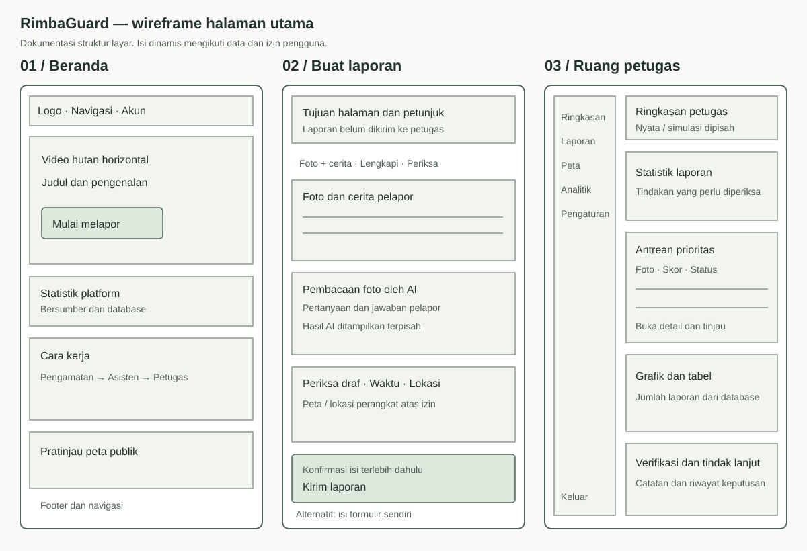
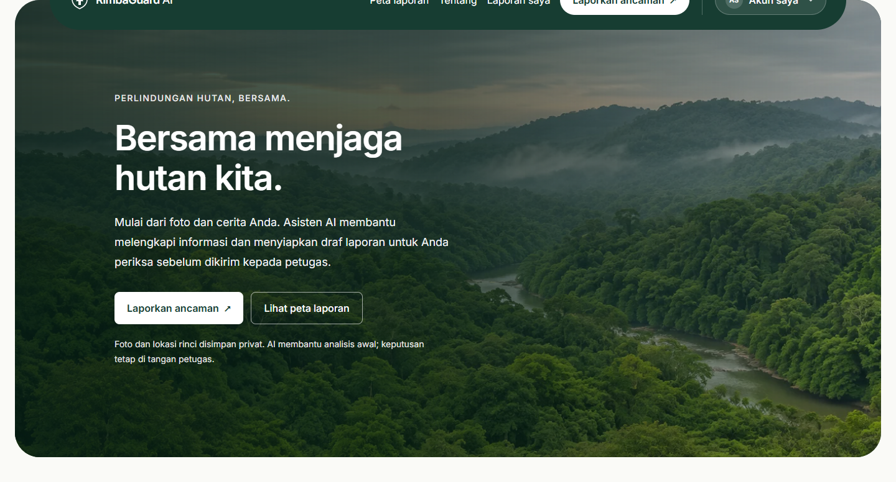
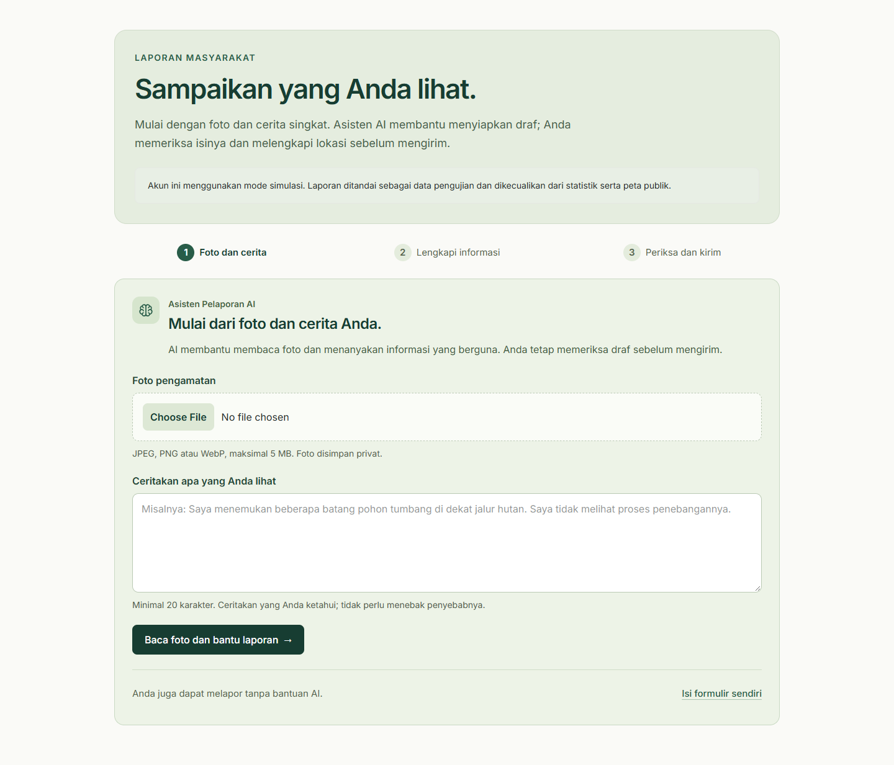
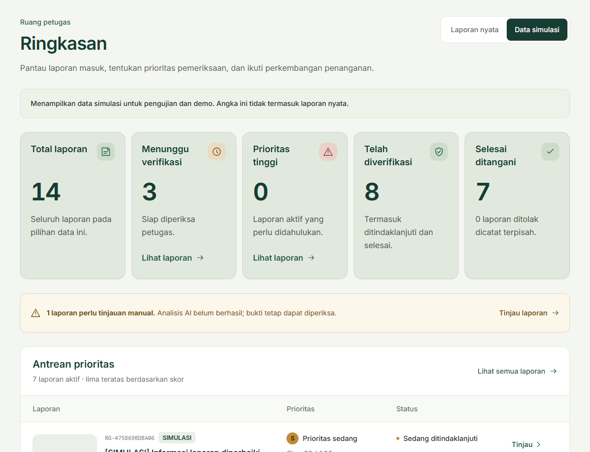

# PROPOSAL WEB DEVELOPMENT

# RimbaGuard AI

**Asisten Pelaporan dan Prioritas Pemeriksaan Ancaman Hutan**

Disusun oleh tim **semogabisamagang**, **Institut Teknologi Del**.

| Identitas anggota | NIM | Peran |
|---|---|---|
| [ISI NANTI SESUAI ARAHAN PENGGUNA] | [ISI NANTI] | [ISI NANTI] |

**WEB DEVELOPMENT IT RUSH 2026**  
Penyelenggara: Program Studi Informatika, Universitas Bengkulu

**Status: draf, belum untuk dikumpulkan.** Struktur mengikuti [template proposal pada guidebook](https://docs.google.com/document/d/1ucioynsv6qkLOYkxLd8ECgqFi53aREY77Q59WscFA1U/edit), diperiksa 20 November 2026. Anggota diisi nanti sesuai arahan pengguna. Nama PDF final: `ITRUSH26_semogabisamagang_RimbaGuardAI.pdf`.

## Kata Pengantar

Proposal ini menjelaskan masalah, rancangan, implementasi dan pengujian RimbaGuard AI. Produk membantu masyarakat menyusun keterangan dugaan ancaman hutan dan membantu petugas memeriksa serta mencatat penanganannya. Asisten AI melengkapi informasi, dengan keputusan verifikasi tetap berada pada manusia.

Penggunaan AI dan perangkat lunak pihak ketiga diungkapkan. Fitur yang diterapkan dibedakan dari rencana pengembangan. Data uji diberi label simulasi; dokumen ini tidak mengklaim dampak lingkungan yang belum diukur.

## Daftar Isi

1. [BAB I — Pendahuluan](#bab-i--pendahuluan)
2. [BAB II — Perencanaan Pengembangan Website](#bab-ii--perencanaan-pengembangan-website)
3. [BAB III — Perancangan Website](#bab-iii--perancangan-website)
4. [BAB IV — Penutup](#bab-iv--penutup)
5. [Daftar Pustaka](#daftar-pustaka)
6. [Lampiran](#lampiran)

Nomor halaman disesuaikan setelah ekspor PDF final.

## BAB I — PENDAHULUAN

### 1.1 Latar Belakang

Foto pohon tumbang memperlihatkan kondisi, tetapi belum menjelaskan apakah pelapor melihat prosesnya, kapan pengamatan berlangsung, dan di mana titik yang perlu diperiksa. Menebak kategori foto saja belum menyelesaikan kebutuhan pelaporan. Keterangan perlu dilengkapi tanpa mendorong pengguna menebak penyebab atau mendekati bahaya.

Petugas memerlukan antrean pemeriksaan, akses bukti dan lokasi, serta riwayat keputusan yang dapat ditelusuri. RimbaGuard menghubungkan penyusunan laporan dengan analisis awal, prioritas yang dapat dijelaskan, verifikasi dan catatan tindak lanjut.

### 1.2 Rumusan Masalah

1. Bagaimana membantu masyarakat menyampaikan informasi yang cukup untuk diperiksa?
2. Bagaimana membedakan keterangan pelapor, interpretasi AI dan hal yang belum diketahui?
3. Bagaimana menyusun urutan pemeriksaan secara transparan?
4. Bagaimana menjaga privasi sambil menyediakan ringkasan publik yang telah ditinjau?
5. Bagaimana mencatat keputusan dan penanganan agar dapat dipantau pelapor?

### 1.3 Tujuan

Menyediakan pelaporan dengan foto, cerita, waktu dan lokasi; asisten untuk meminta informasi pelengkap; prioritas yang dapat ditinjau petugas; serta alur verifikasi dan tindak lanjut yang tersimpan. Formulir manual tetap tersedia ketika AI bermasalah.

### 1.4 Manfaat

Masyarakat diharapkan lebih mudah menyusun keterangan dan memantau statusnya. Petugas memperoleh bukti privat, informasi terstruktur, urutan pemeriksaan dan audit tindakan. Publik melihat ringkasan yang disetujui tanpa foto atau koordinat rinci. Manfaat ini merupakan sasaran rancangan, bukan hasil dampak lapangan yang telah diukur.

## BAB II — PERENCANAAN PENGEMBANGAN WEBSITE

### 2.1 Deskripsi Website

RimbaGuard AI adalah aplikasi web berbahasa Indonesia untuk pelaporan dugaan ancaman hutan berbasis komunitas. Alurnya: foto dan cerita → pertanyaan pelengkap → pemeriksaan draf → waktu/lokasi → konfirmasi pengiriman. Setelah tersimpan, laporan menerima analisis ancaman dan perhitungan prioritas sebelum diperiksa petugas.

AI sebelum pengiriman membantu melengkapi keterangan; AI setelah pengiriman membantu triase. Keduanya tidak menetapkan legalitas, memastikan penyebab, atau menggantikan pemeriksaan manusia.

### 2.2 Unique Selling Point (USP)

- **Pertanyaan sesuai konteks.** Foto dan cerita digunakan untuk menanyakan maksimal tiga hal yang belum jelas. Jawaban *Saya tidak tahu* diperbolehkan.
- **Sumber keterangan terjaga.** Deskripsi mempertahankan cerita asli dan jawaban pelapor. Pengamatan serta ringkasan AI tidak disalin menjadi kesaksian pengguna.
- **Prioritas dapat dijelaskan.** Skor memakai keparahan 35%, kelengkapan 25%, kebaruan 20%, dan laporan serupa 20%. Komponen, alasan dan versi disimpan. Bobot adalah aturan produk awal, bukan model bahaya ilmiah tervalidasi.
- **Laporan berlanjut sampai keputusan.** Petugas memverifikasi, meminta informasi atau menolak, kemudian mencatat penanganan dan riwayatnya.

Kebaruan yang diajukan adalah rancangan penerapan dan integrasi alur tersebut. Tim tidak mengklaim menemukan model AI atau menjadi aplikasi pelaporan pertama.

### 2.3 Target Market dan Pengguna

| Pengguna | Kebutuhan dan akses |
|---|---|
| Masyarakat | Membuat laporan, memakai asisten/manual, melihat bukti/status sendiri dan melengkapi informasi. |
| Petugas konservasi | Meninjau bukti, analisis dan skor; memverifikasi; mencatat penanganan serta audit. |
| Pengunjung publik | Mengenal produk dan melihat ringkasan yang disetujui untuk dipublikasikan. |

Pengelola kawasan dan komunitas konservasi merupakan calon pihak yang dapat diajak mengevaluasi produk. Belum ada klaim kemitraan atau penggunaan resmi oleh institusi tertentu.

### 2.4 Potensi Pengembangan dan Monetisasi

Opsi keberlanjutan yang dapat dikaji adalah kemitraan institusi untuk hosting, dukungan operasional, penyesuaian alur kerja dan pelatihan petugas. Pelaporan masyarakat direncanakan tetap mudah diakses; bukti dan identitas pelapor tidak dijual.

Ini masih rencana. MVP belum memiliki pembayaran, langganan, pelanggan berbayar atau angka pendapatan.

### 2.5 Metode Pembuatan/Pengembangan

Pengembangan bertahap meliputi fondasi, aplikasi publik/pelaporan, AI, prioritas dan peta, ruang petugas, kemudian QA. Asisten ditambahkan setelah alur dasar stabil. Setiap fase diperiksa melalui tipe, build dan pengujian relevan.

Nuxt 4/Vue dan TypeScript melayani antarmuka serta API server. Tailwind CSS dan Inter mendukung hierarki informasi. Supabase menyediakan Auth, PostgreSQL/RLS dan Storage privat. Gemini dipanggil dari server menggunakan foto terverifikasi yang dinormalisasi menjadi JPEG. Zod memvalidasi input/JSON keluaran. Leaflet/OpenStreetMap dengan clustering menampilkan lokasi; Chart.js dan tabel alternatif menyajikan statistik database.

## BAB III — PERANCANGAN WEBSITE

### 3.1 Fitur Website

| Fitur yang diterapkan | Fungsi |
|---|---|
| Autentikasi dan peran | Registrasi, konfirmasi email, login, sesi, logout dan pembatasan akses di server. |
| Asisten pelaporan | Pembacaan foto/cerita, pertanyaan, draf privat, pemulihan dan konfirmasi eksplisit. |
| Formulir manual | Foto, deskripsi, kategori, waktu dan lokasi; tetap tersedia saat AI gagal. |
| Pilihan lokasi | Lokasi perangkat atas izin, titik peta atau koordinat manual. |
| Analisis dan prioritas | JSON AI tervalidasi dan skor transparan untuk antrean petugas. |
| Laporan dan koreksi | Persistensi, detail, status, permintaan informasi dan perbaikan pelapor. |
| Ruang petugas | Ringkasan, antrean dengan foto, peta, analitik, verifikasi, penanganan dan audit. |
| Peta publik | Ringkasan yang disetujui, koordinat dibulatkan; simulasi tidak dapat dipublikasikan. |

### 3.2 Arsitektur Sistem dan User Flow

Browser berkomunikasi dengan API Nuxt melalui sesi HttpOnly dan pemeriksaan origin. Unggahan memakai signed upload URL; browser tidak menerima key layanan. Server memverifikasi gambar, menyimpan JPEG tersegel dan memanggil Gemini dengan foto/teks. PostgreSQL menjadi otoritas transaksi, izin, revisi, status dan audit.

**Alur pelapor:** foto/cerita → pertanyaan → periksa draf → waktu/lokasi → konfirmasi → laporan tersimpan. Alternatif manual bergabung pada tahap pengiriman.

**Alur petugas:** antrean → bukti/analisis/skor → verifikasi, penolakan atau permintaan informasi → tindak lanjut → selesai. Koreksi pelapor memicu penilaian ulang. Retry pengiriman dengan kunci/payload identik memakai laporan yang sama.

Detail ada di [ARCHITECTURE.md](ARCHITECTURE.md) dan [API.md](API.md).

### 3.3 Wireframe Website

Wireframe mendokumentasikan struktur antarmuka. Kotak dan label adalah tata letak, bukan statistik atau hasil AI.

### 3.4 Tampilan UI Website

Tangkapan layar berikut berasal dari aplikasi lokal pada 20 November 2026. Halaman privat menggunakan akun QA; label simulasi tetap terlihat. Ini dokumentasi UI aktual, bukan bukti deployment publik.

**Beranda**

**Penyusunan laporan dengan asisten**

**Ringkasan ruang petugas**

## BAB IV — PENUTUP

### 4.1 Kesimpulan

RimbaGuard menghubungkan pengamatan masyarakat dengan penyusunan keterangan, prioritas pemeriksaan dan penanganan petugas. Pembeda utamanya adalah kelengkapan informasi dan keterlacakan keputusan. Implementasi memakai database sungguhan, pembatasan akses, JSON AI tervalidasi dan konfirmasi pengguna.

Audit 20 November 2026 mencatat 353 unit test, typecheck/build, 31 skenario browser UI/keamanan/peta, dan SQL lokal lulus. Perjalanan asisten dengan Gemini/Supabase nyata, unggahan 5 MB/koreksi dan alur petugas juga lulus pada pengujian ulang. Analisis setelah pengiriman tersimpan sebagai `succeeded` menggunakan `gemini-3.5-flash-lite`. Satu percobaan awal mengalami gangguan provider; kegagalannya tersimpan tanpa hasil buatan. Cakupan dan keterbatasan ada di [catatan audit](COMPETITION_IMPROVEMENT_PLAN.md).

### 4.2 Saran

Berikutnya adalah pengujian pada Delcom dan evaluasi bersama calon pelapor/petugas. Evaluasi dapat mengukur penyelesaian formulir, kelengkapan informasi dan waktu pemeriksaan. Angka belum diisi karena pengukuran pengguna lapangan belum dilakukan.

AI dapat salah membaca foto. Confidence bukan probabilitas terkalibrasi, skor bukan bukti kebenaran, dan laporan berdekatan bukan konfirmasi kejadian. Peta adalah peta laporan insiden, tanpa deteksi deforestasi/satelit. Saat provider gagal, draf/laporan dipertahankan, tersedia retry/manual, dan petugas dapat memeriksa bukti.

## Daftar Pustaka

1. Panitia IT RUSH 2026. *GUIDEBOOK WEB DEV IT RUSH*. PDF dari pengguna; halaman 4–5 untuk berkas dan bobot penilaian.
2. Panitia IT RUSH 2026. [Template Proposal Web Development](https://docs.google.com/document/d/1ucioynsv6qkLOYkxLd8ECgqFi53aREY77Q59WscFA1U/edit), diperiksa 20 November 2026.
3. Tim semogabisamagang. [PRD](../PRD.md), [arsitektur](ARCHITECTURE.md) dan [API](API.md). Spesifikasi dan implementasi proyek.
4. Nuxt. [Dokumentasi](https://nuxt.com/docs/4.x/getting-started/introduction).
5. Supabase. [Dokumentasi](https://supabase.com/docs).
6. Google AI for Developers. [Dokumentasi Gemini API](https://ai.google.dev/gemini-api/docs).
7. Leaflet. [Dokumentasi](https://leafletjs.com/reference.html); OpenStreetMap. [Atribusi](https://www.openstreetmap.org/copyright).

## Lampiran

| Komponen guidebook | Bukti yang dapat diperiksa |
|---|---|
| Fungsionalitas dan kualitas teknis 25% | Persistensi, bukti privat, transisi, filter, audit, izin dan error layanan. |
| Inovasi dan ketepatan solusi 20% | Pertanyaan pelengkap, pemisahan sumber, konfirmasi dan prioritas transparan. |
| Relevansi tema dan dampak 15% | Alur masyarakat → pemeriksaan → tindak lanjut; manfaat dirumuskan sebagai sasaran. |
| UI/UX 15% | Bahasa Indonesia, tahapan, manual alternatif, izin lokasi, responsif dan keyboard. |
| Source code 15% | Tipe/validasi, service, migrasi/RLS, tes dan riwayat commit; perubahan terbaru perlu dipush. |
| Dokumentasi 10% | Struktur template, wireframe, UI aktual, README, arsitektur dan naskah video. |

**Penggunaan AI/aset.** Gemini membantu penyusunan dan analisis awal laporan; tidak ada pelatihan model sendiri. Codex/ChatGPT membantu pengembangan dan peninjauan kode. Tim perlu meninjau hasil serta bertanggung jawab atas pengumpulan. Gambar dekoratif hasil AI tidak digunakan sebagai bukti kejadian. Sumber/prompt/lisensi ada di [ATTRIBUTION.md](../public/images/ATTRIBUTION.md). Paket pihak ketiga mencakup Nuxt, Vue, Supabase, Zod, Tailwind, Leaflet, OpenStreetMap, Chart.js, Sharp, Inter, Vitest, Playwright dan axe.

| Keperluan final | Status |
|---|---|
| Anggota, NIM dan peran | Diisi nanti sesuai arahan pengguna. |
| URL HTTPS Delcom | Belum deploy; pengguna mengerjakan setelah perbaikan komponen selesai. |
| Repository | https://github.com/panjieyna/rimbaguard — publik; perubahan terbaru belum dipush saat audit 20 November. |
| Akun demo | Siapkan untuk pengumpulan privat; jangan commit password. |
| Video Unlisted 3–5 menit | [ISI TAUTAN AKHIR]; naskah di [DEMO.md](DEMO.md). |
| Proposal PDF | Ekspor setelah isian, nomor halaman dan pengujian hosting selesai. |
| Surat orisinalitas/AI | Isi template dengan identitas dan keterangan yang benar; ditandatangani anggota berwenang. Jangan menyalin identitas contoh pada dokumen tertaut. |

Menurut guidebook, tenggat 20 November 2026 pukul 23.59 WIB dan aplikasi aktif sampai 30 November. Hanya berkas lengkap yang dinilai. Draf ini belum menyatakan pengumpulan telah dilakukan.
