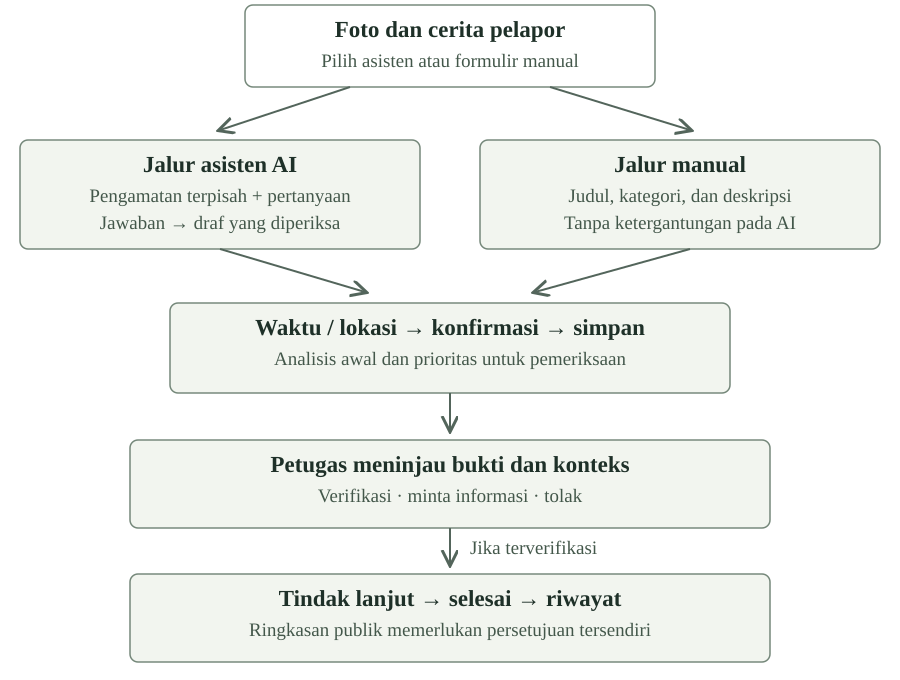
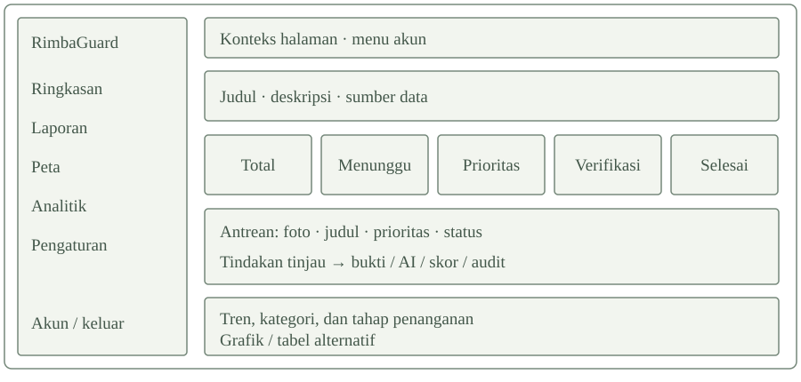
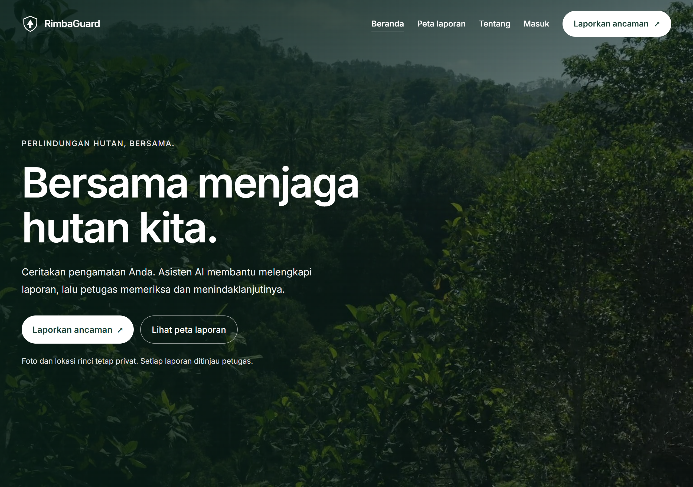
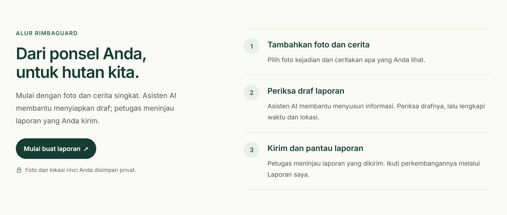
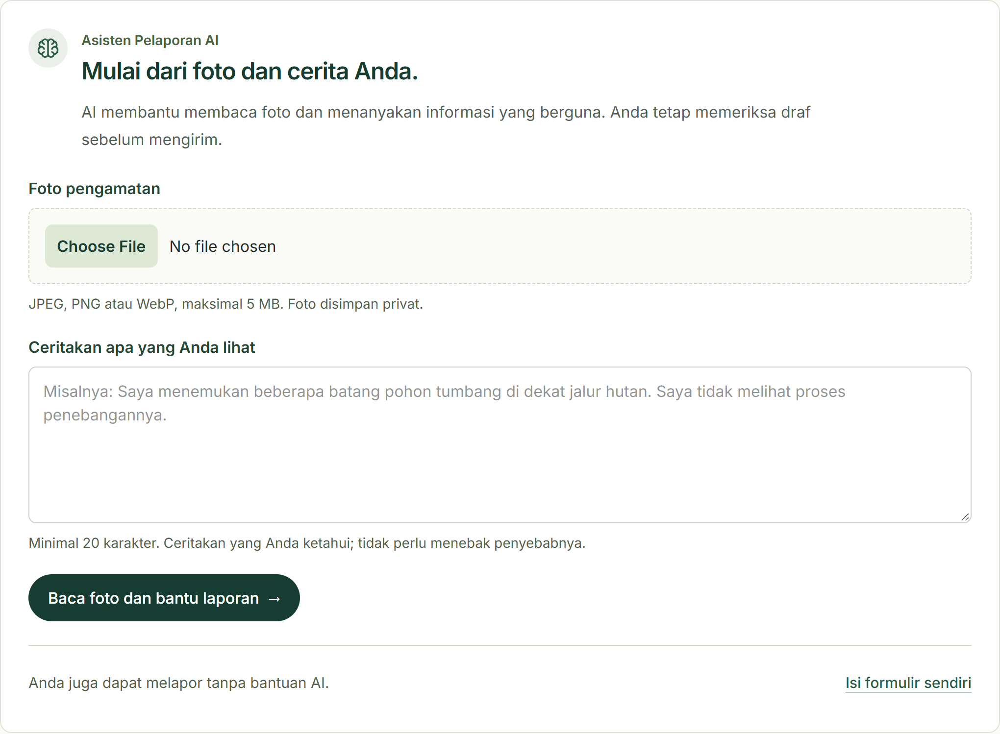
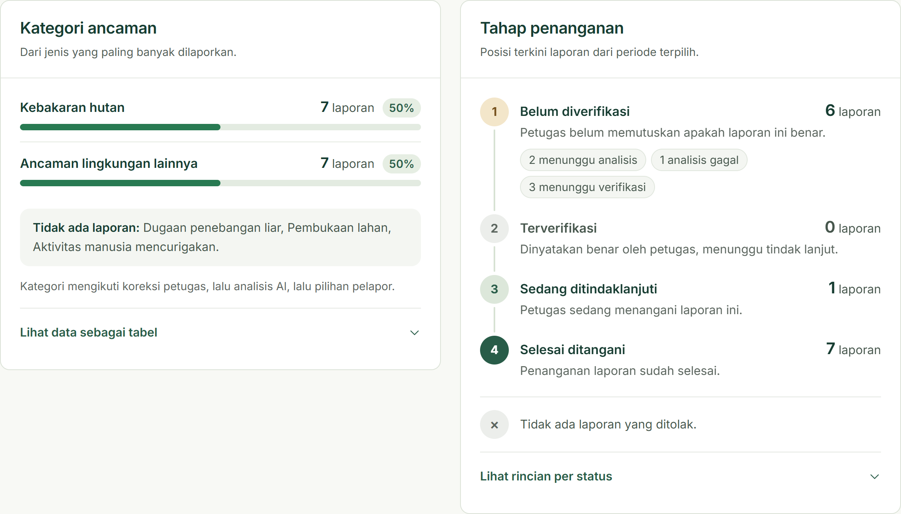
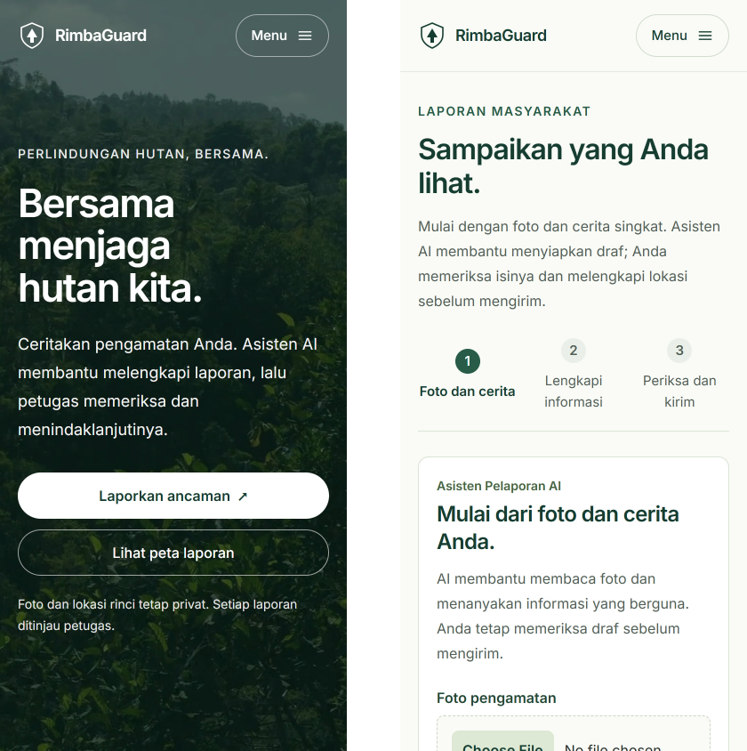

<!-- page: cover -->
# PROPOSAL WEB DEVELOPMENT

# RimbaGuard

**Asisten Pelaporan dan Prioritas Pemeriksaan Ancaman Hutan**

Disusun oleh tim **semogabisamagang**

**Institut Teknologi Del**

| Nama penyusun | NIM | Kedudukan |
|---|---|---|
| Panji Ananda Lumbantoruan | 11S24044 | Ketua |
| Daniel Simanjuntak | 11S24021 | Anggota |
| Jose Simon Harris Purba | 11S24012 | Anggota |
| Martulut Simbolon | 11S24042 | Anggota |

**WEB DEVELOPMENT IT RUSH 2026**

**PROGRAM STUDI INFORMATIKA**

**UNIVERSITAS BENGKULU**

**2026**

Subtema: Lingkungan dan Konservasi

<!-- page: preface -->
## KATA PENGANTAR

Proposal ini menjelaskan konsep, perencanaan, perancangan, implementasi, dan pengujian RimbaGuard dalam kompetisi Web Development IT RUSH 2026. Karya ini memilih subtema **Lingkungan dan Konservasi**, dengan fokus pada pelaporan dugaan ancaman terhadap hutan dan pengelolaan pemeriksaan oleh petugas.

RimbaGuard berangkat dari gagasan bahwa sebuah foto perlu disertai konteks agar dapat diperiksa. Asisten Pelaporan AI membantu masyarakat menyusun keterangan dari foto dan cerita, menanyakan informasi yang belum jelas, lalu menyiapkan draf untuk diperiksa pelapor. Setelah laporan terkirim, petugas memperoleh bukti privat, analisis awal, urutan prioritas, dan riwayat penanganan dalam satu ruang kerja.

RimbaGuard telah berjalan di [ifs24044-rimbaguard.s1if.cloud](https://ifs24044-rimbaguard.s1if.cloud) dan dapat dicoba langsung menggunakan akun demo pada Lampiran D. Kode sumber tersedia di repository publik, dan setiap perubahan diuji otomatis sebelum di-deploy.

Penggunaan layanan Gemini, AI coding assistant, aset visual, dan perangkat lunak pihak ketiga diungkapkan dalam Lampiran C serta README. Proposal ini mengikuti struktur template resmi panitia. [1][2] Kami berterima kasih kepada panitia IT RUSH 2026 atas kesempatan untuk menghadirkan solusi ini.

**23 November 2026**

**Tim semogabisamagang**

<!-- page: contents -->
## DAFTAR ISI

<!-- generated-toc -->

<!-- page: figures -->
## DAFTAR GAMBAR

<!-- generated-figures -->

<!-- page: introduction -->
## BAB I — PENDAHULUAN

### 1.1 Latar Belakang

Tekanan terhadap hutan Indonesia masih tinggi. Kementerian Kehutanan mencatat deforestasi netto **175.400 hektare** sepanjang 2024, hasil dari deforestasi bruto 216.200 hektare dikurangi reforestasi 40.800 hektare. [9] Kebakaran hutan dan lahan menghanguskan sekitar **359.000 hektare** pada 2025, dengan Nusa Tenggara Timur sebagai provinsi paling terdampak. [10] Pada Januari–Juli 2026, SiPongi mencatat **202.004,30 hektare** areal terbakar, naik **69 persen** dibandingkan periode yang sama tahun 2025. [11]

Angka nasional tersebut diperoleh terutama dari pemantauan citra satelit. [9] Citra menunjukkan di mana tutupan hutan berubah, tetapi tidak menjelaskan apa yang dilihat orang di lokasi: tumpukan kayu, asap pertama, atau alat berat yang baru masuk. Masyarakat di sekitar hutan dapat menangkap tanda awal seperti itu, tetapi pengamatan mereka sering berhenti sebagai foto tanpa keterangan.

Permasalahan yang diangkat adalah **kesenjangan antara pengamatan awal dan laporan yang dapat diperiksa**. Foto tidak dengan sendirinya menjelaskan kapan pengamatan dilakukan, di mana lokasinya, apa yang dilihat langsung, dan bagian mana yang masih dugaan. Formulir panjang membebani pelapor, sedangkan klasifikasi foto saja tidak melengkapi konteks. Di sisi petugas, laporan perlu diurutkan, diperiksa berdasarkan bukti, dan diikuti catatan keputusan. [3]

RimbaGuard menjawabnya dengan alur foto dan cerita, pertanyaan pelengkap oleh AI, pemeriksaan draf oleh pelapor, serta pengisian waktu dan lokasi sebelum konfirmasi. Laporan yang tersimpan menerima analisis awal dan skor prioritas yang transparan. Petugas tetap memutuskan validitas, meminta perbaikan informasi, dan mencatat tindak lanjut. Foto dan koordinat rinci hanya terlihat oleh pelapor dan petugas; publik melihat ringkasan yang disetujui dengan lokasi yang digeneralisasi.

### 1.2 Rumusan Masalah

1. Bagaimana membantu masyarakat menyampaikan laporan yang cukup lengkap tanpa harus menebak penyebab kejadian?
2. Bagaimana memisahkan keterangan pelapor, pengamatan visual AI, dan informasi yang belum diketahui?
3. Bagaimana menentukan urutan pemeriksaan secara transparan dan dapat ditinjau petugas?
4. Bagaimana menjaga bukti serta lokasi rinci sambil menyediakan informasi publik yang telah diperiksa?
5. Bagaimana mencatat keputusan dan tindak lanjut agar perkembangan laporan dapat dipantau?

### 1.3 Tujuan

Tujuan umum proyek ini adalah membangun aplikasi web yang menghubungkan pengamatan masyarakat dengan pemeriksaan dan penanganan dugaan ancaman hutan secara terstruktur.

Tujuan khususnya adalah:

1. Menyediakan pelaporan dengan foto, cerita, waktu, dan lokasi, melalui asisten maupun formulir manual.
2. Mengintegrasikan AI untuk mengajukan pertanyaan pelengkap serta menyiapkan draf yang wajib diperiksa pelapor sebelum dikirim.
3. Menyimpan laporan, bukti, hasil analisis, dan riwayat tindakan secara persisten dengan pembatasan akses.
4. Menyediakan prioritas berbasis aturan yang memperlihatkan komponen, alasan, dan versi perhitungannya.
5. Mendukung verifikasi, permintaan informasi, penolakan, tindak lanjut, dan penyelesaian oleh petugas.
6. Menyediakan peta publik yang hanya memuat ringkasan laporan yang disetujui.

### 1.4 Manfaat

| Penerima manfaat | Manfaat yang dituju |
|---|---|
| Masyarakat | Menyusun laporan dengan bantuan pertanyaan yang jelas, mengetahui informasi yang perlu dilengkapi, dan memantau perkembangan laporan sendiri. |
| Petugas | Memusatkan bukti, konteks, antrean prioritas, keputusan, serta catatan penanganan dalam satu ruang kerja. |
| Pengunjung publik | Melihat ringkasan yang telah ditinjau tanpa membuka foto maupun koordinat rinci pelapor. |
| Pengelola kawasan | Memperoleh data tren, kategori ancaman, dan tahap penanganan untuk perencanaan patroli. |

Manfaat tersebut akan diukur pada uji coba bersama lembaga mitra dengan tiga indikator: persentase laporan yang memuat foto, waktu, dan lokasi lengkap; waktu dari laporan masuk hingga keputusan petugas; serta proporsi laporan yang memerlukan permintaan informasi tambahan.

<!-- page: concept -->
## BAB II — PERENCANAAN PENGEMBANGAN WEBSITE

### 2.1 Deskripsi Website

RimbaGuard adalah aplikasi web berbahasa Indonesia untuk pelaporan dugaan ancaman hutan berbasis komunitas. Pelapor memulai dari foto dan cerita singkat. Asisten membaca keduanya, memisahkan pengamatan visual dari keterangan pelapor, kemudian mengajukan paling banyak tiga pertanyaan yang relevan. Pelapor dapat menjawab sesuai pengetahuannya atau memilih **Saya tidak tahu**.

Draf baru menjadi laporan setelah pelapor memeriksa isinya, melengkapi waktu dan lokasi, serta mencentang konfirmasi. Setelah tersimpan, analisis awal dan skor prioritas membantu petugas menyusun urutan pemeriksaan. Formulir manual tetap tersedia ketika layanan AI tidak dapat digunakan.

Cakupan yang telah berjalan meliputi autentikasi dan pengaturan akun, pelaporan, bukti privat, lokasi, asisten, analisis awal, prioritas, verifikasi, penanganan, audit, peta, dan analitik.

### 2.2 Unique Selling Point (USP)

**Pelengkap konteks, bukan sekadar label foto.** AI mengubah pengamatan awal menjadi keterangan yang terstruktur. Pertanyaan menargetkan informasi yang belum jelas, dan pelapor tidak didorong menebak jawaban yang tidak diketahuinya.

**Asal informasi tetap terbaca.** Cerita dan jawaban pelapor disimpan sebagai keterangannya sendiri. Ringkasan dan pengamatan visual AI disajikan terpisah, sehingga interpretasi model tidak berubah menjadi kesaksian pelapor.

**Prioritas yang dapat dijelaskan.** Urutan pemeriksaan memakai empat komponen dengan bobot yang terlihat. Petugas dapat membaca alasan, sumber kategori, serta riwayat perhitungannya.

**Proses berlanjut sampai tindak lanjut.** Laporan terhubung dengan permintaan perbaikan, keputusan, status penanganan, dan audit. Kebaruannya terletak pada integrasi seluruh alur tersebut dalam satu aplikasi yang memanfaatkan model Gemini.

| Pendekatan yang ada | Kekuatan | Celah yang diisi RimbaGuard |
|---|---|---|
| Kanal pengaduan umum, misalnya SP4N-LAPOR! [12] | Resmi dan mencakup seluruh layanan publik | Formulir umum tidak menanyakan detail khas kejadian hutan dan tidak menyusun prioritas pemeriksaan |
| Pemantauan citra satelit [9] | Cakupan luas dan konsisten | Menunjukkan perubahan tutupan, bukan keterangan saksi di lapangan |
| Foto melalui media sosial atau grup percakapan | Cepat dan akrab bagi warga | Waktu dan lokasi sering tidak lengkap, informasi tercecer, dan tidak ada jejak tindak lanjut |

RimbaGuard melengkapi kanal-kanal tersebut: pengamatan warga dikumpulkan secara terstruktur, diurutkan dengan alasan yang terbuka, dan diikuti sampai selesai ditangani.

### 2.3 Target Market dan Pengguna

| Kelompok pengguna | Kebutuhan utama dan akses |
|---|---|
| Pelapor masyarakat | Membuat laporan, memakai asisten atau formulir manual, melihat foto dan status laporan sendiri, serta melengkapi informasi ketika diminta. |
| Petugas pemeriksa | Mengakses bukti dan lokasi, memeriksa analisis serta prioritas, memverifikasi, mencatat penanganan, dan membaca audit. |
| Pengunjung publik | Memahami tujuan produk serta melihat perkiraan lokasi dan perkembangan ringkasan yang dipublikasikan petugas. |

Sasaran adopsi pertama adalah Kesatuan Pengelolaan Hutan (KPH), balai taman nasional, komunitas konservasi, serta instansi yang menerima pengaduan lingkungan.

Antarmuka menggunakan bahasa Indonesia, tahapan yang jelas, label status berbentuk teks, dan penanda prioritas yang tidak bergantung pada warna saja. Lokasi dapat dipilih melalui izin perangkat, titik di peta, atau koordinat manual, sehingga pelapor tetap dapat melapor ketika izin lokasi ditolak.

### 2.4 Potensi Pengembangan dan Monetisasi

Pelaporan oleh masyarakat selalu gratis. Keberlanjutan dibiayai oleh lembaga yang memanfaatkan ruang kerja petugas. Bukti dan identitas pelapor tidak pernah dijual sebagai produk data.

| Sumber pendanaan | Bentuk |
|---|---|
| Langganan lembaga | Ruang kerja petugas per KPH, taman nasional, atau organisasi: antrean prioritas, peta, analitik, dan audit. |
| Kemitraan CSR dan hibah lingkungan | Pembiayaan hosting dan layanan AI untuk wilayah dampingan. |
| Jasa implementasi | Penyesuaian kategori dan bobot prioritas, integrasi sistem, serta pelatihan petugas. |

Biaya operasional utama adalah hosting, pemanggilan Gemini per laporan, dan penyimpanan foto. Biaya per laporan akan dihitung pada uji coba sebagai dasar penetapan tarif.

Pengembangan berikutnya meliputi notifikasi perkembangan laporan, penugasan petugas, mode luring (PWA) untuk wilayah dengan sinyal lemah, dan integrasi dengan sistem operasional pengelola kawasan.

### 2.5 Metode Pembuatan/Pengembangan

Pengembangan dilakukan bertahap: fondasi; aplikasi publik dan pelaporan; integrasi AI; prioritas dan peta; ruang petugas; penguatan kualitas; lalu deployment. Asisten pelaporan ditambahkan setelah alur dasar stabil. Setiap tahap diperiksa melalui pengujian, pemeriksaan tipe, dan build, dan catatannya tersimpan dalam IMPLEMENTATION_PLAN.md. [3]

| Teknologi | Peran dalam implementasi |
|---|---|
| Nuxt 4, Vue, TypeScript | Halaman publik/privat, komponen antarmuka, dan API server dalam satu proyek. [4] |
| Tailwind CSS dan Inter | Gaya antarmuka, token warna, tipografi, serta tata letak responsif. |
| Supabase | Auth, PostgreSQL, kebijakan Row Level Security, dan penyimpanan gambar privat. [5] |
| Gemini API dan Zod | Pemrosesan foto/teks di server serta validasi masukan dan keluaran terstruktur. [6] |
| Sharp | Memeriksa, menormalisasi, membuang metadata, dan menyiapkan turunan gambar. |
| Leaflet dan OpenStreetMap | Peta lokasi, pengelompokan titik, filter, serta navigasi spasial. [7] |
| Chart.js dan tabel alternatif | Penyajian perkembangan laporan yang dihitung dari database. |
| Vitest, Playwright, dan axe | Pengujian unit, perjalanan browser/API, serta aksesibilitas otomatis. |
| Jenkins dan Delcom | CI/CD: uji otomatis setiap push, lalu deploy ke server HTTPS. |

Source code dipisahkan menjadi halaman/komponen, kontrak bersama, handler API, service, utilitas keamanan, dan migrasi database. Pemisahan ini membuat aturan domain dapat diuji tanpa bergantung pada tampilan, dan skema TypeScript/Zod dipakai bersama oleh browser dan server.

**Pengujian dan deployment berkelanjutan.** Setiap push ke branch `main` memicu pipeline Jenkins: memasang dependensi, menjalankan **371 unit test**, membungkus aplikasi, lalu meminta Delcom melakukan redeploy. Deploy otomatis dibatalkan bila ada satu tes yang gagal. Uji browser dan integrasi layanan nyata dijalankan terpisah; ringkasannya ada pada Lampiran A.

<!-- page: features -->
## BAB III — PERANCANGAN WEBSITE

### 3.1 Fitur Website

| Fitur yang diterapkan | Fungsi dan perilaku |
|---|---|
| Autentikasi dan akun | Registrasi, konfirmasi email, login, foto profil, ubah nama dan kata sandi, keluar dari semua perangkat, serta pembatasan peran pada server. |
| Asisten Pelaporan AI | Foto/cerita, pertanyaan pelengkap, jawaban, draf privat, pemulihan draf, dan konfirmasi sebelum pengiriman. |
| Formulir manual | Judul, kategori, deskripsi, foto, waktu, dan lokasi; tetap dapat digunakan saat AI gagal. |
| Foto bukti | JPEG/PNG/WebP sampai 5 MB; pemeriksaan format, metadata dibuang, bukti tersegel tersimpan privat. |
| Lokasi kejadian | Lokasi perangkat atas izin, titik di peta, atau koordinat manual; penolakan izin tidak menghalangi jalur lain. |
| Analisis awal | Kategori indikasi, pengamatan visual, indikator, alasan, saran, dan riwayat percobaan yang tersimpan. |
| Pemeriksaan petugas | Antrean dengan foto, komponen prioritas, verifikasi, permintaan informasi, penolakan, dan koreksi kategori. |
| Penanganan dan audit | Perkembangan tindak lanjut, penyelesaian, catatan internal, dan riwayat tindakan. |
| Peta dan analitik | Filter laporan, pengelompokan titik, ringkasan periode, kategori, serta tahap penanganan dalam kalimat sederhana. |
| Publikasi terbatas | Ringkasan yang disetujui petugas dan lokasi yang digeneralisasi; data simulasi tidak dapat dipublikasikan. |

Pengiriman berulang dengan kunci idempotensi dan isi yang sama memakai laporan yang sama. Laporan yang dikoreksi dianalisis ulang, dan hasil dari revisi lama tidak dapat menimpa isi yang lebih baru. Kewenangan diterapkan pada API dan database, tidak hanya pada navigasi antarmuka.

**Integrasi AI dan kendali pengguna**

AI dipakai di dua titik. Sebelum pengiriman, asisten menyusun pertanyaan serta draf dari foto dan cerita. Setelah pengiriman, analisis membantu pemeriksaan awal. Permintaan ke Gemini dilakukan dari server, dan keluaran JSON diperiksa terhadap skema Zod sebelum disimpan. [6]

Cerita pelapor dan pengamatan visual diperlakukan sebagai sumber yang berbeda. AI tidak diberi kewenangan menetapkan waktu, lokasi, identitas, penyebab, atau legalitas kejadian tanpa keterangan yang mendukung. Pelapor memeriksa draf dan mengonfirmasi pengiriman; petugas memutuskan hasil akhirnya.

**Prioritas pemeriksaan yang transparan**

Versi aturan yang diterapkan adalah `rimbaguard-priority-v1`. Semua komponen dinormalisasi pada rentang 0–100, lalu digabungkan sebagai berikut. [3]

> Skor = (keparahan × 0,35) + (kelengkapan × 0,25) + (kebaruan × 0,20) + (laporan serupa × 0,20).

| Komponen | Bobot | Dasar penilaian |
|---|---|---|
| Keparahan kategori | 35% | Bobot kategori; sumber kategori: koreksi petugas, AI tervalidasi, lalu pilihan pelapor. |
| Kelengkapan | 25% | Foto, deskripsi, koordinat, waktu, dan nama lokasi. |
| Kebaruan kejadian | 20% | Usia kejadian dengan batas 6, 24, 72, dan 168 jam. |
| Laporan serupa | 20% | Kategori sama, radius 2 km, selisih waktu paling lama 7 hari; jenis data dipisahkan. |

Prioritas tinggi bernilai 75–100, sedang 45 sampai di bawah 75, dan rendah di bawah 45. Perhitungan, alasan, versi, serta waktunya disimpan untuk ditinjau petugas. Skor mengurutkan pemeriksaan, bukan memastikan kejadian, dan bobotnya dapat disesuaikan bersama lembaga mitra.

<!-- page: architecture -->
### 3.2 Arsitektur Sistem dan User Flow

Browser mengakses halaman dan API Nuxt. Server memeriksa sesi, peran, origin, dan input sebelum mengakses layanan. Supabase menangani autentikasi, database, serta Storage; Gemini menerima foto/teks melalui server. Seluruh kunci layanan tetap berada di server. [3]

**Penyimpanan dan konsistensi.** Laporan, draf, hasil analisis, skor, dan audit tersimpan di PostgreSQL. Fungsi transaksi memeriksa revisi serta kewenangan sebelum mengubah status. Lease membatasi pekerjaan AI bersamaan, dan idempotensi mencegah duplikasi akibat pengiriman ulang.

**Bukti privat.** Setelah unggahan, server memastikan gambar dapat didekode, menghapus metadata, dan menyimpan turunan tersegel. Tampilan bukti memerlukan otorisasi dan tautan sementara. Thumbnail tidak mengubah file bukti asli.

**Pemisahan akses.** Pelapor mengakses laporannya sendiri. Petugas mendapat informasi pemeriksaan dan catatan internal. Publik hanya menerima field yang diizinkan dengan koordinat dibulatkan 0,01 derajat, sekitar 1 km. Pembatasan baris diterapkan melalui RLS dan fungsi database. [5]

<!-- page: flow -->
**Alur pelapor dan petugas**

Pelapor memilih asisten atau jalur manual. Kedua jalur bertemu pada pemeriksaan informasi dan konfirmasi. Laporan disimpan lebih dahulu, sehingga gangguan layanan AI tidak menghilangkan catatan yang telah dikirim.

Petugas dapat menyatakan laporan terverifikasi, menolak dengan alasan, atau meminta informasi tambahan. Laporan terverifikasi bergerak ke tahap ditindaklanjuti lalu selesai. Koreksi pelapor memicu penilaian ulang, dan catatan internal tidak ditampilkan kepada pelapor.

Publikasi merupakan tindakan tersendiri setelah verifikasi, dengan ringkasan yang ditinjau petugas. Data simulasi tersedia untuk pengujian dan demonstrasi tanpa masuk ke statistik maupun peta publik.

**Pemulihan kegagalan.** Ketika Gemini tidak tersedia atau keluarannya tidak valid, aplikasi menyimpan status gagal dan menyediakan percobaan ulang serta jalur manual. Jika peta dasar atau izin lokasi bermasalah, koordinat manual tetap tersedia. Kegagalan database ditampilkan sebagai informasi belum dapat dimuat, bukan angka nol buatan.

<!-- page: wireframes -->
### 3.3 Wireframe Website

Wireframe berikut memperlihatkan struktur utama halaman publik dan ruang petugas sebelum diberi gaya visual.

Beranda mengarahkan pengunjung ke pelaporan, dan formulir menempatkan foto serta cerita sebagai langkah pertama. Ruang petugas memisahkan navigasi operasional, kondisi laporan, dan antrean pemeriksaan. Kontrol akun ditempatkan terpisah dari tugas utama.

<!-- page: ui-home -->
### 3.4 Tampilan UI Website

Gambar pada bagian ini diambil dari aplikasi RimbaGuard menggunakan akun uji, pada skala 2× agar tetap jelas saat diperbesar. Angka dan hasil analisis pada gambar berasal dari data simulasi yang benar-benar tersimpan.

Video menjadi pengantar visual, sementara pesan utama, tombol pelaporan, dan alur tetap berupa teks dan kontrol HTML. Pengguna yang mengaktifkan pengurangan gerak melihat poster statis.

<!-- page: ui-report -->
**Autentikasi dan awal penyusunan laporan**

Formulir memakai label yang jelas dan petunjuk singkat. Pelapor dapat memulai dengan asisten atau mengisi sendiri. Foto baru menjadi laporan setelah pelapor melengkapi informasi, memeriksa isi, dan mengonfirmasi pengiriman.

<!-- page: ui-analysis -->
**Hasil AI yang tersimpan**

Gambar memperlihatkan hasil Gemini yang tersimpan untuk foto uji tanpa tanda kerusakan. Model menyatakan kategori dan risiko belum dapat ditentukan, lengkap dengan alasan dan saran pemeriksaan. Ini menunjukkan perilaku yang diharapkan: AI tidak mengarang ancaman yang tidak terlihat.

Indikator, pengamatan, alasan, dan saran ditampilkan terpisah, sehingga petugas dapat menilai dasar setiap kesimpulan sebelum memverifikasi laporan.

<!-- page: ui-officer -->
**Ringkasan dan antrean petugas**

Lima ringkasan memakai label tugas yang mudah dibaca. Foto membantu orientasi awal; detail, analisis, dan komponen skor tersedia saat laporan ditinjau. Petugas dapat berpindah antara laporan nyata dan data simulasi.

<!-- page: ui-analytics -->
**Analitik yang menjelaskan makna angka**

Pilihan periode dan jenis data terlihat di awal. Kategori, tren, serta tahap penanganan dijelaskan dengan kalimat dan angka, disertai tabel alternatif. Ringkasan periode dibedakan dari jumlah seluruh waktu agar angka tidak dibandingkan dengan cakupan berbeda.

<!-- page: ui-map -->
**Peta publik dan penggunaan pada ponsel**

Peta publik hanya memuat ringkasan yang dipublikasikan petugas. Jika belum ada laporan yang layak tampil, peta menampilkan keterangan kosong yang jelas; titik simulasi tidak dipakai untuk mengisi peta.

Peta dasar: © OpenStreetMap contributors, ODbL. Sumber dan lisensi: [https://www.openstreetmap.org/copyright](https://www.openstreetmap.org/copyright). [7]

Tampilan ponsel menggunakan susunan satu kolom, menu ringkas, serta tombol dan label yang tetap terbaca. Navigasi diuji otomatis pada lebar 320 hingga 1440 piksel, termasuk penggunaan keyboard, dan halaman publik dipindai dengan axe.

<!-- page: conclusion -->
## BAB IV — PENUTUP

### 4.1 Kesimpulan

RimbaGuard menghubungkan pengamatan masyarakat dengan pemeriksaan dan penanganan petugas dalam satu alur. Kontribusi utamanya adalah AI yang melengkapi konteks laporan, pemisahan sumber informasi, konfirmasi pelapor, prioritas yang dapat dijelaskan, serta riwayat keputusan. Keputusan verifikasi tetap berada di tangan manusia.

Aplikasi telah berjalan di [ifs24044-rimbaguard.s1if.cloud](https://ifs24044-rimbaguard.s1if.cloud) dengan HTTPS, dan seluruh fitur pada Bab III dapat dicoba menggunakan akun demo di Lampiran D. Setiap perubahan kode melewati **371 unit test** dalam pipeline Jenkins sebelum di-deploy, dilengkapi uji browser, uji aksesibilitas, dan uji integrasi Gemini serta Supabase nyata.

### 4.2 Saran

1. Lakukan uji coba bersama satu KPH atau balai taman nasional, lalu ukur tiga indikator pada bagian 1.4.
2. Tinjau bobot prioritas bersama pihak yang memahami operasional konservasi, dengan versi aturan dan alasan perubahan yang tetap tercatat.
3. Evaluasi akurasi analisis AI pada kumpulan foto lapangan yang telah diberi label oleh petugas.
4. Tambahkan notifikasi, penugasan petugas, dan mode luring untuk wilayah dengan sinyal lemah.
5. Kaji integrasi dengan sistem pengaduan dan patroli lembaga setelah tata kelola data disepakati.

**Batasan saat ini**

RimbaGuard adalah alat bantu pelaporan dan pemeriksaan, bukan pemantauan satelit atau sistem penetapan pelanggaran hukum. Bobot prioritas merupakan aturan awal, dan skor keyakinan AI bukan probabilitas terkalibrasi. Akurasi model pada foto lapangan serta dampak terhadap kecepatan penanganan belum diukur dan menjadi agenda uji coba.

<!-- page: references -->
## DAFTAR PUSTAKA

[1] Panitia IT RUSH 2026. (2026). *GUIDEBOOK WEB DEV IT RUSH*. Dokumen panduan kompetisi. Ketentuan karya: hlm. 3; pengumpulan: hlm. 4–5; rubrik: hlm. 5.

[2] Panitia IT RUSH 2026. (2026). *Template Proposal Web Development*. [Template resmi](https://docs.google.com/document/d/1ucioynsv6qkLOYkxLd8ECgqFi53aREY77Q59WscFA1U/edit). Diakses 22 November 2026. Struktur bab, font, dan format halaman mengacu dokumen ini.

[3] Tim semogabisamagang. (2026). *Dokumentasi dan implementasi RimbaGuard*. [Repository proyek](https://github.com/panjieyna/rimbaguard). Rujukan: PRD.md; IMPLEMENTATION_PLAN.md; docs/ARCHITECTURE.md; docs/API.md; shared/constants/scoring.ts; Jenkinsfile; serta direktori tests/.

[4] Nuxt. (tanpa tahun). *Introduction: Nuxt 4 documentation*. [Dokumentasi resmi Nuxt](https://nuxt.com/docs/4.x/getting-started/introduction). Diakses 22 November 2026.

[5] Supabase. (tanpa tahun). *Row Level Security*. [Dokumentasi resmi Supabase](https://supabase.com/docs/guides/database/postgres/row-level-security). Diakses 22 November 2026.

[6] Google. (tanpa tahun). *Structured outputs: Gemini API*. [Dokumentasi resmi Gemini](https://ai.google.dev/gemini-api/docs/structured-output). Diakses 22 November 2026.

[7] Leaflet. (tanpa tahun). *API reference, versi 1.9.4*. [Dokumentasi Leaflet 1.9.4](https://leafletjs.com/reference-1.9.4.html). OpenStreetMap Foundation. (tanpa tahun). *Copyright and License*. [Atribusi OpenStreetMap](https://www.openstreetmap.org/copyright). Diakses 22 November 2026.

[8] Pexels. (tanpa tahun). *Pexels License*. [Ketentuan aset Pexels](https://www.pexels.com/license/). Nilov, M. (tanpa tahun). *Drone Footage of Trees and Forest*, video 6989121. [Sumber video beranda](https://www.pexels.com/video/drone-footage-of-trees-and-forest-6989121/). Rincian turunan ada pada public/images/ATTRIBUTION.md.

[9] Kompas.com. (21 Maret 2025). *Kemenhut: Deforestasi Indonesia Capai 175.000 Hektare Sepanjang 2024*. [Artikel Kompas Lestari](https://lestari.kompas.com/read/2025/03/21/180000186/kemenhut--deforestasi-indonesia-capai-175.000-hektare-sepanjang-2024-?page=all). Diakses 23 November 2026.

[10] Kompas.com. (26 Maret 2026). *Karhutla Indonesia 2025 Capai 359.000 Hektar, Ini 7 Provinsi yang Rawan*. [Artikel Kompas Lestari](https://lestari.kompas.com/read/2026/03/26/100600886/karhutla-indonesia-2025-capai-359.000-hektar-ini-7-provinsi-yang-rawan). Diakses 23 November 2026.

[11] Kompas.com. (3 Oktober 2026). *Luas Karhutla 2026 Melonjak, Perbaikan Tata Kelola Lahan dan Gambut Jadi Sorotan*. Mengutip data SiPongi Kementerian Kehutanan. [Artikel Kompas Lestari](https://lestari.kompas.com/read/2026/10/03/093745086/luas-karhutla-2026-melonjak-perbaikan-tata-kelola-lahan-dan-gambut-jadi). Diakses 23 November 2026.

[12] SP4N-LAPOR!. (tanpa tahun). *Apa Itu LAPOR!?* [Halaman resmi LAPOR!](https://www.lapor.go.id/about). Diakses 23 November 2026.

<!-- page: testing -->
## LAMPIRAN A — HASIL VERIFIKASI

| Pemeriksaan | Waktu dan hasil |
|---|---|
| Website live | 23 November: HTTPS dengan sertifikat Let's Encrypt aktif; layanan Supabase dan Gemini terhubung; kedua akun demo berhasil masuk, dan akun petugas dapat membuka ringkasan, antrean laporan, peta, serta analitik. |
| Pipeline CI/CD | 23 November: Jenkins menjalankan Checkout, Install & Test, Package, Publish, dan Deploy hingga status berhasil di Delcom. |
| Unit test | 371 tes dalam 23 berkas lulus dengan Vitest, dijalankan ulang otomatis pada setiap deploy. |
| Pemeriksaan tipe dan build | 22 November: `nuxt typecheck` lulus. 23 November: build produksi lulus di server Delcom. |
| Regresi publik dan autentikasi | 22 November: 21 skenario browser lulus untuk halaman publik dan tata letak autentikasi. |
| Aksesibilitas | 22 November: pemindaian axe lintas halaman pada beberapa lebar layar lulus. |
| Alur fitur menyeluruh | 20 November: 34 skenario lulus pada dua eksekusi, termasuk pelaporan/koreksi, keamanan, peta, asisten, dan alur petugas. |
| Integrasi AI nyata | 18–20 November: Gemini dan Supabase nyata menghasilkan draf serta analisis tervalidasi yang tersimpan. |
| Uji database | 18 November: 26 asersi SQL untuk alur asisten lulus tanpa error pada database hosted. |

Kode pengujian tersedia di direktori tests/ pada repository, dan konfigurasi pipeline tersedia pada Jenkinsfile. Uji dengan fixture dan uji layanan nyata dijalankan terpisah dan tidak digabungkan sebagai satu angka.

<!-- page: rubric -->
## LAMPIRAN B — PEMETAAN RUBRIK PENILAIAN

| Komponen guidebook | Bukti dalam karya dan proposal |
|---|---|
| Fungsionalitas dan kualitas teknis — 25% | Website live, Bagian 3.1–3.2, dan Lampiran A: persistensi, unggahan, pemulihan draf, konfirmasi, idempotensi, izin, transisi, audit, dan pemulihan kegagalan. |
| Inovasi dan ketepatan solusi — 20% | Bagian 2.1–2.2: pertanyaan pelengkap, pemisahan keterangan dan interpretasi, prioritas transparan, serta perbandingan dengan pendekatan yang ada. |
| Relevansi tema dan dampak — 15% | Bagian 1.1–1.4 dan 4.2: data deforestasi dan karhutla, manfaat, indikator dampak, dan rencana uji coba. |
| UI dan UX — 15% | Bagian 3.3–3.4: wireframe, UI aktual, tahapan, bahasa Indonesia, jalur manual, izin lokasi, dan tampilan ponsel. |
| Kualitas source code — 15% | Bagian 2.5 dan 3.2: TypeScript, validasi Zod, service, migrasi, RLS, transaksi, pengujian, dan CI/CD. |
| Dokumentasi karya — 10% | Proposal sesuai template, daftar pustaka, atribusi, lampiran bukti, README, dan video demo. Tautan dan akun demo pada Lampiran D. |

Website live, repository, video demo, dan proposal memakai versi karya yang sama. [1]

<!-- page: attribution -->
## LAMPIRAN C — PENGUNGKAPAN AI, ASET, DAN LIBRARY

**AI sebagai fitur produk.** Gemini API dipakai untuk asisten penyusunan laporan dan analisis awal foto/teks. Tim tidak melatih model sendiri. Keluaran diperiksa terhadap skema, disimpan bersama versi dan riwayatnya, dan tetap ditinjau petugas.

**AI coding assistant.** Sesuai ketentuan guidebook, penggunaan OpenAI Codex/ChatGPT dan Claude Code (Anthropic) dicatat di sini dan di README. Bantuan mencakup perencanaan, pengembangan dan peninjauan kode, pengujian, perbaikan antarmuka, serta dokumentasi. Tim meninjau setiap hasil dan bertanggung jawab atas kebenaran karya.

**Aset yang digunakan.** Video beranda berasal dari *Drone Footage of Trees and Forest* karya Mikhail Nilov, Pexels video 6989121, sesuai Pexels License. Turunan web berupa potongan delapan detik tanpa suara, kompresi, dan poster. Video bersifat dekoratif, bukan dokumentasi kejadian. [8]

Gambar hutan pada halaman Tentang dan autentikasi dibuat dengan OpenAI image generation dan bersifat dekoratif. Sumber, prompt, dan perubahan tercatat di public/images/ATTRIBUTION.md. Susunan navigasi dan video beranda terinspirasi dari tata letak Gojek.io; identitas, aset, dan implementasinya sepenuhnya milik RimbaGuard.

**Library dan layanan.** Nuxt/Vue, TypeScript, Tailwind CSS, Inter, Supabase, Gemini API, Zod, Sharp, Leaflet, leaflet.markercluster, OpenStreetMap, Chart.js, Vitest, Playwright, axe, Jenkins, dan Delcom digunakan sesuai perannya. Versi dependensi tersedia dalam package.json dan package-lock.json. Data peta mengikuti atribusi OpenStreetMap. [7]

**Gambar proposal.** Tangkapan layar berasal dari aplikasi RimbaGuard dengan akun uji, dan dataset simulasi ditandai. Diagram arsitektur, alur, serta wireframe adalah gambar vektor buatan tim.

Surat Pernyataan Orisinalitas dan Penggunaan AI dilampirkan sebagai berkas terpisah sesuai template panitia.

<!-- page: access -->
## LAMPIRAN D — AKSES KARYA DAN AKUN DEMO

Juri dapat mencoba RimbaGuard secara langsung melalui tautan dan akun berikut. Kedua akun disiapkan khusus untuk penjurian. [1]

| Kanal akses | Tautan |
|---|---|
| Website (HTTPS) | [ifs24044-rimbaguard.s1if.cloud](https://ifs24044-rimbaguard.s1if.cloud) |
| Repository source code | [github.com/panjieyna/rimbaguard](https://github.com/panjieyna/rimbaguard) |
| Video demo (YouTube Unlisted) | {{VIDEO_LINK}} |

| Akun demo | Email | Kata sandi |
|---|---|---|
| Pelapor | `pelapor@rimbaguard.test` | {{JURI_PELAPOR_PASSWORD}} |
| Petugas | `admin@rimbaguard.test` | {{JURI_PETUGAS_PASSWORD}} |

**Langkah uji yang disarankan**

1. Masuk sebagai **Pelapor**, pilih **Laporkan ancaman**, lalu unggah foto dan cerita singkat.
2. Jawab pertanyaan Asisten AI atau pilih **Saya tidak tahu**, periksa draf, tandai lokasi di peta, centang konfirmasi, lalu kirim.
3. Buka **Laporan saya** untuk melihat status dan hasil analisis AI.
4. Keluar, lalu masuk sebagai **Petugas**. Buka **Laporan**, pilih laporan tadi, dan periksa bukti, analisis AI, serta komponen skor.
5. Pada bagian **Verifikasi dan penanganan**, pilih **Verifikasi laporan** atau **Minta informasi tambahan**.
6. Buka **Analitik** dan pilih **Data simulasi** untuk melihat dataset uji yang lebih lengkap, lalu buka **Peta** untuk melihat sebaran laporan beserta filternya.

Untuk penjurian, gunakan kedua akun demo di atas.
