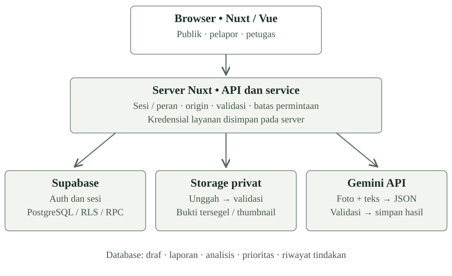
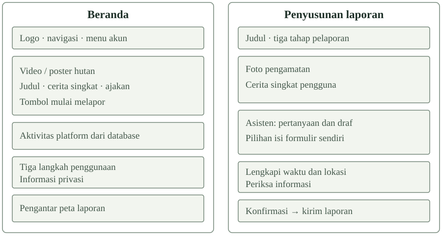
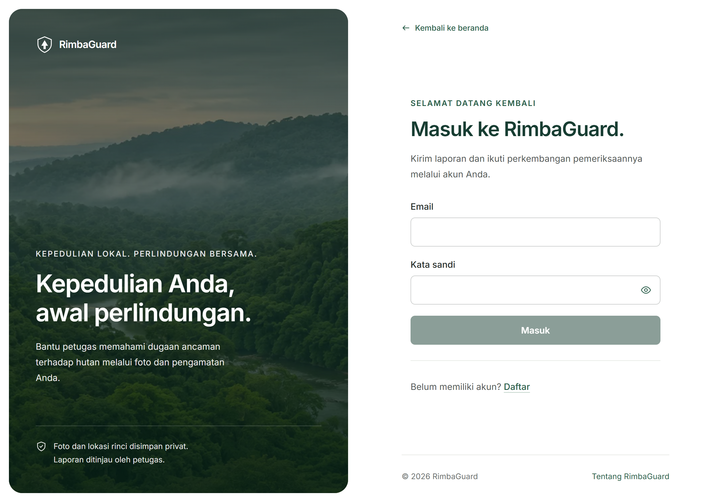
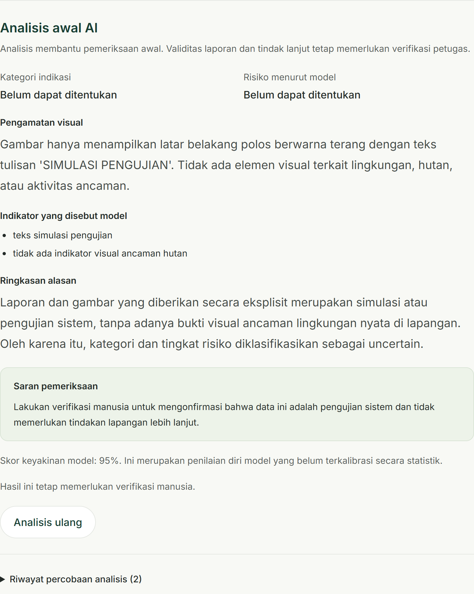
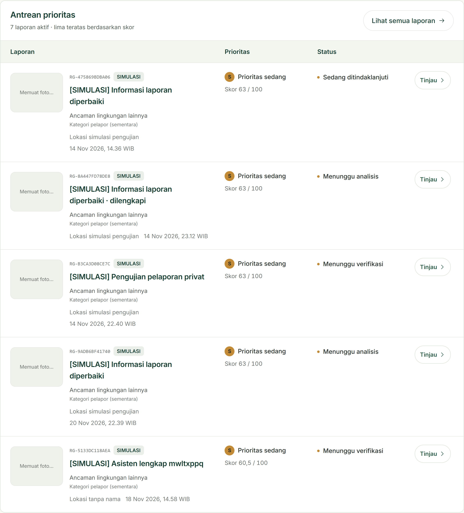
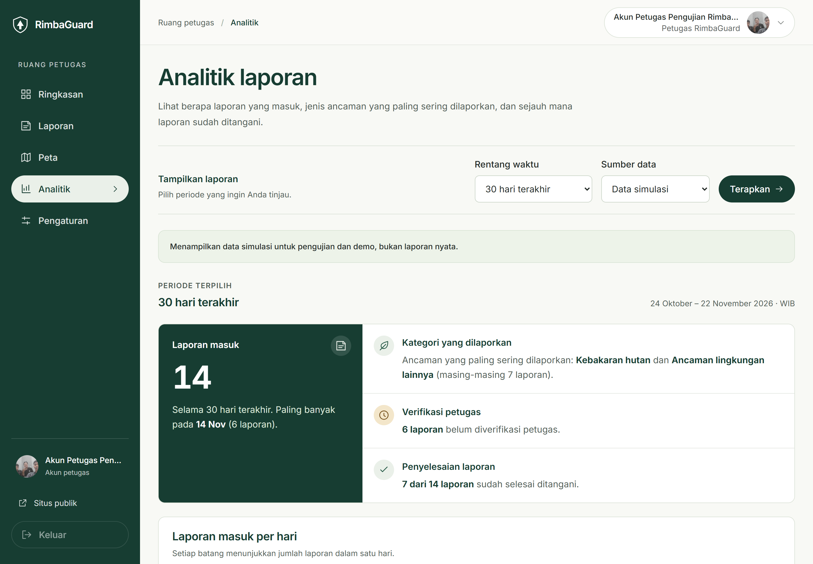
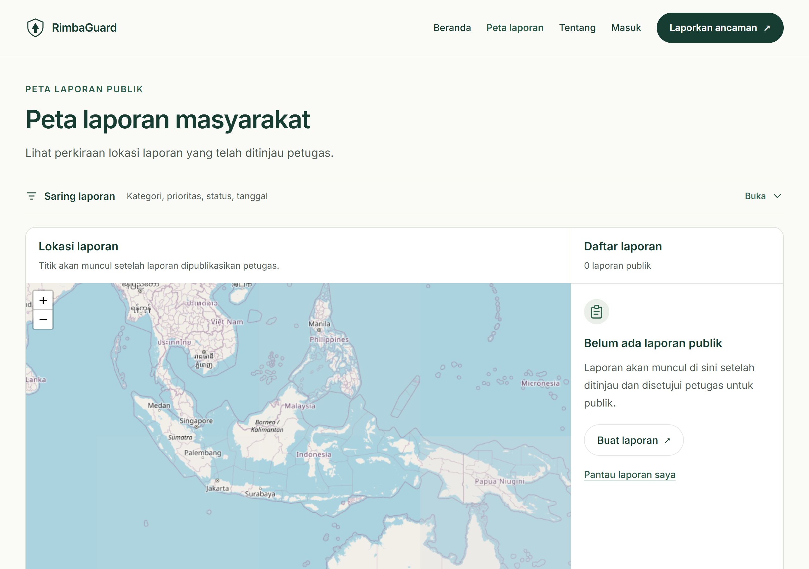

<!-- page: cover -->
# PROPOSAL WEB DEVELOPMENT

# RimbaGuard

**Asisten Pelaporan dan Prioritas Pemeriksaan Ancaman Hutan**

Disusun oleh tim **semogabisamagang**

**Institut Teknologi Del**

| Nama penyusun | NIM | Kedudukan |
|---|---|---|
| Panji Ananda Lumbantoruan | 11S24044 | Ketua |
| Daniel Simanjuntak | 11S24021 | Anggota |
| Jose Simon Harris Purba | 11S24012 | Anggota |
| Martulut Simbolon | 11S24042 | Anggota |

**WEB DEVELOPMENT IT RUSH 2026**

**PROGRAM STUDI INFORMATIKA**

**UNIVERSITAS BENGKULU**

**2026**

Versi tinjauan • 22 November 2026

<!-- page: preface -->
## KATA PENGANTAR

Proposal ini disusun untuk menjelaskan konsep, perencanaan, perancangan, implementasi, dan pengujian RimbaGuard dalam kompetisi Web Development IT RUSH 2026. Karya ini memilih subtema **Lingkungan dan Konservasi**, dengan fokus pada pelaporan dugaan ancaman terhadap hutan dan pengelolaan pemeriksaan oleh petugas.

RimbaGuard dikembangkan dengan gagasan bahwa sebuah foto perlu disertai konteks agar dapat diperiksa. Asisten Pelaporan AI membantu masyarakat menyusun keterangan dari foto dan cerita, meminta informasi yang belum jelas, serta menyiapkan draf untuk diperiksa pengguna. Setelah pengiriman, petugas memperoleh bukti privat, analisis awal, urutan prioritas, dan riwayat penanganan dalam satu alur.

Uraian proposal bersumber dari implementasi proyek, catatan pengujian, guidebook kompetisi, dan dokumentasi resmi teknologi. Tangkapan layar diambil langsung dari aplikasi lokal terbaru pada 22 November 2026. Data simulasi tetap dinyatakan sebagai data uji. Manfaat yang belum diukur melalui evaluasi lapangan disajikan sebagai sasaran pengembangan, bukan hasil penelitian.

Penggunaan layanan Gemini, AI coding assistant, aset visual, dan perangkat lunak pihak ketiga diungkapkan dalam lampiran serta README. Tanggung jawab peninjauan dan pengumpulan karya berada pada tim penyusun. Proposal ini mengikuti struktur template resmi, termasuk pembahasan monetisasi sebagai rencana keberlanjutan. [1][2]

Versi ini disiapkan untuk peninjauan. Tautan website dan video dikosongkan atas arahan tim; bagian akun demo disediakan untuk dilengkapi menjelang pengumpulan. Pemeriksaan pada URL produksi akan dicatat terpisah setelah alamatnya diberikan.

**22 November 2026**

**Tim semogabisamagang**

<!-- page: contents -->
## DAFTAR ISI

<!-- generated-toc -->

<!-- page: figures -->
## DAFTAR GAMBAR

<!-- generated-figures -->

<!-- page: introduction -->
## BAB I — PENDAHULUAN

### 1.1 Latar Belakang

Pengamatan masyarakat dapat menjadi titik awal pemeriksaan dugaan ancaman terhadap hutan. Namun, foto pohon tumbang, tumpukan kayu, atau sampah di jalur hutan belum memberikan seluruh informasi yang dibutuhkan petugas. Foto tidak dengan sendirinya menjelaskan kapan pengamatan dilakukan, di mana lokasi kejadian, apa yang dilihat langsung, dan bagian mana yang masih merupakan dugaan pelapor.

Permasalahan yang diangkat dalam proyek ini adalah **kesenjangan antara pengamatan awal dan laporan yang dapat diperiksa**. Sebuah formulir panjang dapat membebani pelapor, sedangkan klasifikasi foto saja belum melengkapi konteks kejadian. Di sisi petugas, laporan perlu disusun dalam antrean, diperiksa berdasarkan bukti, dan diikuti catatan keputusan serta perkembangan penanganan. Kebutuhan tersebut dirumuskan dalam PRD proyek dan menjadi dasar rancangan, bukan kesimpulan dari survei pengguna yang belum dilakukan. [3]

RimbaGuard menawarkan alur foto dan cerita, pertanyaan pelengkap oleh AI, pemeriksaan draf oleh pelapor, pengisian waktu dan lokasi, serta konfirmasi pengiriman. Laporan yang tersimpan kemudian menerima analisis awal dan prioritas berbasis aturan. Petugas tetap memutuskan validitas, meminta perbaikan informasi, dan mencatat tindak lanjut.

Privasi menjadi bagian rancangan. Foto serta koordinat rinci dibatasi bagi pemilik laporan dan petugas. Informasi publik berasal dari ringkasan yang disetujui petugas, dengan lokasi yang digeneralisasi. Dengan demikian, keterbukaan informasi tetap memiliki batas yang jelas.

### 1.2 Rumusan Masalah

1. Bagaimana membantu masyarakat menyampaikan laporan yang cukup lengkap tanpa harus menebak penyebab kejadian?
2. Bagaimana memisahkan keterangan pelapor, pengamatan visual AI, dan informasi yang belum diketahui?
3. Bagaimana menentukan urutan pemeriksaan secara transparan dan dapat ditinjau petugas?
4. Bagaimana menjaga bukti serta lokasi rinci sambil menyediakan informasi publik yang telah diperiksa?
5. Bagaimana mencatat keputusan dan tindak lanjut agar perkembangan laporan dapat dipantau?

<!-- page: objectives -->
### 1.3 Tujuan

Tujuan umum proyek ini adalah membangun aplikasi web yang menghubungkan pengamatan masyarakat dengan pemeriksaan dan penanganan dugaan ancaman hutan secara terstruktur.

Tujuan khususnya adalah:

1. Menyediakan pelaporan dengan foto, cerita, waktu, dan lokasi, melalui asisten maupun formulir manual.
2. Mengintegrasikan AI untuk mengajukan pertanyaan pelengkap serta menyiapkan draf yang wajib diperiksa pengguna sebelum dikirim.
3. Menyimpan laporan, bukti, hasil analisis, dan riwayat tindakan secara persisten dengan pembatasan akses.
4. Menyediakan prioritas berbasis aturan yang memperlihatkan komponen, alasan, dan versi perhitungannya.
5. Mendukung verifikasi, permintaan informasi, penolakan, tindak lanjut, dan penyelesaian oleh petugas.
6. Menyediakan peta publik yang hanya memuat ringkasan laporan yang disetujui.

### 1.4 Manfaat

| Penerima manfaat | Manfaat yang dituju |
|---|---|
| Masyarakat | Membantu menyusun keterangan, mengetahui informasi yang perlu dilengkapi, dan memantau perkembangan laporan sendiri. |
| Petugas | Memusatkan bukti, konteks, antrean prioritas, keputusan, serta catatan penanganan dalam satu ruang kerja. |
| Pengunjung publik | Memberikan akses pada ringkasan yang telah ditinjau tanpa membuka foto maupun koordinat rinci. |
| Pengelola dan pengembang | Menyediakan dasar evaluasi kelengkapan laporan, keterlacakan proses, dan pengembangan alur kerja berikutnya. |

Manfaat tersebut merupakan sasaran rancangan. Tim belum melakukan survei lapangan, mengukur pengurangan kerusakan hutan, atau membuktikan peningkatan kecepatan penanganan pada organisasi konservasi. Evaluasi lanjutan dirumuskan pada bagian 4.2.

<!-- page: concept -->
## BAB II — PERENCANAAN PENGEMBANGAN WEBSITE

### 2.1 Deskripsi Website

RimbaGuard adalah aplikasi web berbahasa Indonesia untuk pelaporan dugaan ancaman hutan berbasis komunitas. Pengguna memulai dari foto dan cerita singkat. Asisten membaca keduanya, memisahkan pengamatan visual dari keterangan pengguna, kemudian mengajukan paling banyak tiga pertanyaan yang relevan. Pengguna dapat menjawab sesuai pengetahuan atau memilih **Saya tidak tahu**.

Draf belum menjadi laporan sebelum pelapor memeriksa isinya, melengkapi waktu dan lokasi, serta memberikan konfirmasi pengiriman. Setelah tersimpan, analisis awal dan skor prioritas membantu petugas menyusun urutan pemeriksaan. Formulir manual tetap tersedia ketika layanan AI tidak dapat digunakan.

Lingkup MVP mencakup autentikasi, pelaporan, bukti privat, lokasi, asisten, analisis awal, prioritas, verifikasi, penanganan, audit, peta, dan analitik. Pemantauan satelit, penetapan legalitas, deteksi deforestasi otomatis, dan koordinasi kedaruratan bukan kemampuan produk saat ini.

### 2.2 Unique Selling Point (USP)

**Pelengkap konteks, bukan sekadar label foto.** AI digunakan untuk membantu mengubah pengamatan awal menjadi keterangan yang lebih terstruktur. Pertanyaan menargetkan informasi yang belum jelas; pengguna tidak didorong memberikan jawaban yang tidak diketahui.

**Asal informasi tetap terbaca.** Cerita dan jawaban pengguna dipertahankan sebagai keterangannya. Ringkasan dan pengamatan visual AI disajikan terpisah, sehingga interpretasi model tidak otomatis menjadi kesaksian pelapor.

**Prioritas yang dapat dijelaskan.** Urutan pemeriksaan memakai empat komponen dengan bobot yang terlihat. Petugas dapat membaca alasan, sumber kategori, serta riwayat perhitungannya.

**Proses berlanjut sampai tindak lanjut.** Laporan dihubungkan dengan permintaan perbaikan, keputusan, status penanganan, dan audit. Kebaruan yang diajukan adalah penerapan serta integrasi alur tersebut; tim tidak mengklaim menciptakan model AI atau menjadi aplikasi pelaporan pertama.

<!-- page: users -->
### 2.3 Target Market dan Pengguna

| Kelompok pengguna | Kebutuhan utama dan akses |
|---|---|
| Pelapor masyarakat | Membuat laporan, memakai asisten atau manual, melihat foto/status sendiri, dan melengkapi informasi ketika diminta. |
| Petugas pemeriksa | Mengakses bukti dan lokasi, memeriksa analisis/prioritas, memverifikasi, mencatat penanganan, dan membaca audit. |
| Pengunjung publik | Memahami tujuan produk serta melihat perkiraan lokasi dan perkembangan ringkasan yang dipublikasikan petugas. |

Pengelola kawasan, komunitas konservasi, dan institusi yang menangani pengaduan lingkungan merupakan calon pihak untuk evaluasi berikutnya. Belum ada klaim kemitraan, pelanggan, atau penggunaan resmi oleh organisasi tertentu.

Antarmuka menggunakan bahasa Indonesia, tahapan yang jelas, label status berbentuk teks, dan penanda prioritas yang tidak bergantung pada warna saja. Lokasi dapat dipilih melalui izin perangkat, titik peta, atau koordinat manual. Rancangan ini ditujukan untuk mengurangi hambatan penggunaan; efektivitas pada seluruh kelompok usia tetap perlu diuji bersama pengguna sasaran.

### 2.4 Potensi Pengembangan dan Monetisasi

Keberlanjutan yang dapat dikaji adalah kemitraan antarinstitusi untuk biaya hosting, dukungan operasional, pelatihan petugas, dan penyesuaian alur pemeriksaan. Pelaporan masyarakat direncanakan tetap mudah diakses. Bukti serta identitas pelapor tidak dijadikan produk data untuk dijual.

Pengembangan berikutnya dapat mencakup penugasan petugas, notifikasi perkembangan, dan integrasi dengan proses operasional pengelola kawasan setelah kebutuhan divalidasi. Penambahan fitur perlu mempertimbangkan biaya layanan AI, perlindungan data, kemampuan operator, dan hasil evaluasi lapangan.

Pembahasan ini merupakan **rencana keberlanjutan** sesuai template proposal. MVP belum memiliki sistem pembayaran, langganan, pelanggan berbayar, atau pendapatan. Angka biaya dan proyeksi keuntungan belum dicantumkan karena belum tersedia dasar perhitungan yang terverifikasi.

<!-- page: methodology -->
### 2.5 Metode Pembuatan/Pengembangan

Pengembangan dilakukan bertahap: fondasi; aplikasi publik dan pelaporan; integrasi AI; prioritas dan peta; ruang petugas; kemudian penguatan kualitas serta dokumentasi. Asisten pelaporan ditambahkan setelah alur dasar stabil. Setiap tahap diperiksa melalui pengujian yang sesuai, pemeriksaan tipe, dan build. Catatan fase serta perbaikan tersimpan dalam IMPLEMENTATION_PLAN.md. [3]

| Teknologi | Peran dalam implementasi |
|---|---|
| Nuxt 4, Vue, TypeScript | Halaman publik/privat, komponen antarmuka, dan API server dalam satu proyek. [4] |
| Tailwind CSS dan Inter | Gaya antarmuka, token warna, tipografi, serta tata letak responsif. |
| Supabase | Auth, PostgreSQL, kebijakan Row Level Security, dan penyimpanan gambar privat. [5] |
| Gemini API dan Zod | Pemrosesan foto/teks di server serta validasi masukan dan keluaran terstruktur. [6] |
| Sharp | Memeriksa, menormalisasi, membuang metadata, dan menyiapkan turunan gambar. |
| Leaflet dan OpenStreetMap | Peta lokasi, pengelompokan titik, filter, serta navigasi spasial. [7] |
| Chart.js dan tabel alternatif | Penyajian perkembangan laporan yang dihitung dari database. |
| Vitest, Playwright, dan axe | Pengujian unit, perjalanan browser/API, serta aksesibilitas otomatis. |

Source code dipisahkan menjadi halaman/komponen, kontrak bersama, handler API, service, utilitas keamanan, dan migrasi database. Pemisahan ini menjaga aturan domain dapat diperiksa tanpa bergantung pada tampilan. Skema TypeScript/Zod digunakan bersama untuk mengurangi ketidaksesuaian kontrak.

Pengujian dibedakan antara unit, database, browser dengan fixture, integrasi layanan nyata, dan pemeriksaan antarmuka. Hasil dari waktu dan cakupan berbeda tidak dijumlahkan sebagai satu suite. Ringkasan bukti terbaru dan batasnya disajikan pada Lampiran A.

<!-- page: features -->
## BAB III — PERANCANGAN WEBSITE

### 3.1 Fitur Website

| Fitur yang diterapkan | Fungsi dan perilaku |
|---|---|
| Autentikasi dan akun | Registrasi, konfirmasi email, login, sesi, profil, logout, dan pembatasan peran pada server. |
| Asisten Pelaporan AI | Foto/cerita, pertanyaan pelengkap, jawaban, draf privat, pemulihan draf, dan konfirmasi sebelum pengiriman. |
| Formulir manual | Judul, kategori, deskripsi, foto, waktu, dan lokasi; tetap dapat digunakan saat AI gagal. |
| Foto bukti | JPEG/PNG/WebP sampai 5 MB; pemeriksaan format, metadata dibuang, bukti tersegel tersimpan privat. |
| Lokasi kejadian | Lokasi perangkat atas izin, titik di peta, atau koordinat manual; penolakan izin tidak menghalangi jalur alternatif. |
| Analisis awal | Kategori indikasi, pengamatan visual, indikator, alasan, saran, dan riwayat percobaan yang tersimpan. |
| Pemeriksaan petugas | Antrean dengan foto, komponen prioritas, verifikasi, permintaan informasi, penolakan, dan koreksi kategori. |
| Penanganan dan audit | Perkembangan tindak lanjut, penyelesaian, catatan internal, dan riwayat tindakan. |
| Peta dan analitik | Filter laporan, pengelompokan titik, ringkasan periode, kategori, serta tahap penanganan. |
| Publikasi terbatas | Ringkasan yang disetujui petugas dan lokasi yang digeneralisasi; data simulasi tidak dapat dipublikasikan. |

Pengiriman berulang dengan kunci idempotensi dan payload identik memakai laporan yang sama. Laporan yang dikoreksi kembali dianalisis; hasil dari revisi lama tidak boleh menggantikan isi yang lebih baru. Kewenangan diterapkan pada API dan database, tidak hanya pada navigasi antarmuka.

<!-- page: ai-priority -->
**Integrasi AI dan kendali pengguna**

Ada dua penggunaan AI. Sebelum pengiriman, asisten menyusun pertanyaan serta draf dari foto dan cerita. Setelah pengiriman, analisis membantu pemeriksaan awal. Permintaan Gemini dilakukan dari server; keluaran JSON diperiksa terhadap skema sebelum disimpan. Dukungan structured output pada API tidak menggantikan validasi dan pemeriksaan manusia. [6]

Cerita pelapor dan pengamatan visual diperlakukan sebagai sumber yang berbeda. Pengguna memeriksa draf serta mengonfirmasi pengiriman. AI tidak diberi kewenangan menetapkan waktu, lokasi, identitas, penyebab, atau legalitas kejadian tanpa keterangan yang mendukung.

**Prioritas pemeriksaan yang transparan**

Versi aturan yang diterapkan adalah `rimbaguard-priority-v1`. Semua komponen dinormalisasi pada rentang 0–100, lalu digabungkan sebagai berikut. [3]

> Skor = (keparahan × 0,35) + (kelengkapan × 0,25) + (kebaruan × 0,20) + (laporan serupa × 0,20).

| Komponen | Bobot | Dasar penilaian |
|---|---|---|
| Keparahan kategori | 35% | Bobot kategori; sumber kategori: koreksi petugas, AI tervalidasi, lalu pilihan pelapor. |
| Kelengkapan | 25% | Foto, deskripsi, koordinat, waktu, dan nama lokasi. |
| Kebaruan kejadian | 20% | Usia kejadian dengan batas 6, 24, 72, dan 168 jam. |
| Laporan serupa | 20% | Kategori sama, radius 2 km, selisih waktu paling lama 7 hari; jenis data dipisahkan. |

Prioritas tinggi bernilai 75–100, sedang 45 sampai di bawah 75, dan rendah di bawah 45. Perhitungan, alasan, versi, serta waktunya disimpan untuk ditinjau petugas.

Bobot merupakan aturan awal produk, bukan model bahaya ilmiah yang telah divalidasi. Kelengkapan bukan keaslian bukti; kedekatan laporan bukan konfirmasi kejadian. Skor keyakinan AI juga bukan probabilitas terkalibrasi.

<!-- page: architecture -->
### 3.2 Arsitektur Sistem dan User Flow

Browser mengakses halaman dan API Nuxt. Server memeriksa sesi, peran, origin, dan input sebelum mengakses layanan. Supabase menangani autentikasi, database, serta Storage; Gemini menerima foto/teks melalui server. Kunci layanan tetap berada di server. [3]

**Penyimpanan dan konsistensi.** Laporan, draf, hasil analisis, skor, dan audit tersimpan di PostgreSQL. Fungsi transaksi memeriksa revisi serta kewenangan sebelum mengubah status. Lease membatasi pekerjaan AI bersamaan; idempotensi menghindari duplikasi akibat pengiriman ulang.

**Bukti privat.** Setelah unggahan, server memastikan gambar dapat didekode, menghapus metadata, dan menyimpan turunan tersegel. Tampilan bukti memerlukan otorisasi dan akses sementara. Thumbnail tidak mengubah file bukti asli.

**Pemisahan akses.** Pelapor mengakses laporannya sendiri. Petugas mendapat informasi pemeriksaan dan catatan internal. Publik hanya menerima proyeksi field yang diizinkan dan koordinat dibulatkan 0,01 derajat, sekitar 1 km dengan variasi menurut lintang. Prinsip pembatasan baris diterapkan melalui RLS dan fungsi database. [5]

<!-- page: flow -->
**Alur pelapor dan petugas**

Pelapor memilih asisten atau jalur manual. Kedua jalur bertemu pada pemeriksaan informasi dan konfirmasi. Laporan disimpan lebih dahulu, sehingga gangguan layanan AI tidak menghilangkan catatan yang telah dikirim.

Petugas dapat menyatakan laporan terverifikasi, menolak dengan alasan, atau meminta informasi tambahan. Laporan terverifikasi dapat bergerak ke tahap ditindaklanjuti lalu selesai. Koreksi pelapor memicu penilaian ulang. Catatan internal tidak ditampilkan kepada pelapor.

Publikasi merupakan tindakan tersendiri setelah verifikasi, dengan ringkasan yang ditinjau petugas. Data simulasi tetap tersedia untuk pengujian dan demonstrasi tanpa masuk ke statistik/peta publik.

**Pemulihan kegagalan.** Ketika Gemini tidak tersedia atau keluarannya tidak valid, aplikasi menyimpan status gagal dan menyediakan percobaan ulang/manual. Jika peta dasar atau izin lokasi bermasalah, pilihan koordinat manual tetap tersedia. Kegagalan database ditampilkan sebagai informasi belum dapat dimuat, bukan angka nol buatan.

<!-- page: wireframes -->
### 3.3 Wireframe Website

Wireframe berikut mendokumentasikan struktur utama implementasi saat ini. Kotak dan garis merupakan rancangan tata letak; tidak mewakili statistik, bukti, atau hasil AI.

Beranda mengarahkan pengguna ke pelaporan; formulir menempatkan foto dan cerita sebagai awal. Ruang petugas memisahkan navigasi operasional, kondisi laporan, dan antrean pemeriksaan. Kontrol akun/keluar ditempatkan terpisah dari tugas utama.

<!-- page: ui-home -->
### 3.4 Tampilan UI Website

Seluruh gambar UI pada bagian ini berasal dari aplikasi lokal pada **22 November 2026**, dengan nama produk RimbaGuard. Gambar diambil pada skala 2× agar tetap jelas saat diperbesar. Pemotongan panel hanya membatasi area dokumentasi; data dan hasil analisis tidak direkayasa.

Video berfungsi sebagai pengantar visual. Pesan utama, tombol pelaporan, serta alur tetap berupa teks dan kontrol HTML. Mode pengurangan gerak memakai poster; isi halaman tetap dapat dibaca tanpa animasi.

<!-- page: ui-report -->
**Autentikasi dan awal penyusunan laporan**

Formulir memakai label yang jelas dan petunjuk singkat. Pelapor dapat memulai dengan asisten atau mengisi sendiri. Foto tidak menjadi laporan sampai pengguna melengkapi informasi, memeriksa isi, dan memberikan konfirmasi pengiriman.

<!-- page: ui-analysis -->
**Hasil AI yang tersimpan dan batas interpretasinya**

Gambar memperlihatkan hasil yang sudah tersimpan dari pemanggilan Gemini pada data uji. Foto fixture berisi teks simulasi; model menyatakan kategori serta risiko belum dapat ditentukan. Tampilan ini menunjukkan respons ketidakpastian yang sebenarnya, bukan contoh deteksi ancaman yang direkayasa. Tidak ada generasi AI baru saat pengambilan gambar.

Indikator, pengamatan, alasan, dan saran ditampilkan terpisah. Hasil tersebut tetap memerlukan verifikasi petugas. Keberhasilan teknis mendapatkan keluaran tervalidasi tidak sama dengan bukti akurasi model pada foto lapangan.

<!-- page: ui-officer -->
**Ringkasan dan antrean petugas**

Lima ringkasan memakai label tugas yang mudah dibaca. Foto membantu orientasi awal; detail, analisis, dan komponen skor tersedia saat laporan ditinjau. Angka pada gambar berasal dari dataset simulasi yang tersimpan, bukan jumlah kejadian hutan nyata.

<!-- page: ui-analytics -->
**Analitik yang menjelaskan makna angka**

Pilihan periode dan jenis data terlihat di awal. Kategori, tren, serta tahap penanganan dijelaskan dengan kalimat dan angka, disertai tabel alternatif. Ringkasan periode dibedakan dari jumlah seluruh waktu agar pengguna tidak membandingkan angka dengan cakupan berbeda.

<!-- page: ui-map -->
**Peta publik dan penggunaan pada ponsel**

Peta publik hanya memuat ringkasan yang dipublikasikan petugas. Keadaan kosong dipertahankan jika belum ada laporan yang layak tampil. Titik simulasi tidak dipindahkan ke peta publik untuk mengisi ruang kosong.

Peta dasar: © OpenStreetMap contributors, ODbL. Sumber dan lisensi: [https://www.openstreetmap.org/copyright](https://www.openstreetmap.org/copyright). [7]

Tampilan ponsel menggunakan susunan satu kolom, menu ringkas, serta tombol dan label yang tetap terbaca. Pemeriksaan responsif dan keyboard merupakan bukti teknis terbatas; kemudahan bagi seluruh usia memerlukan evaluasi pengguna lanjutan.

<!-- page: conclusion -->
## BAB IV — PENUTUP

### 4.1 Kesimpulan

RimbaGuard menerapkan alur dari pengamatan masyarakat hingga pemeriksaan dan penanganan petugas. Kontribusi utamanya adalah penggunaan AI untuk melengkapi konteks laporan, pemisahan sumber informasi, konfirmasi pengguna, prioritas yang dapat dijelaskan, serta riwayat keputusan. Pendekatan ini mempertahankan keputusan verifikasi pada manusia.

MVP telah memiliki antarmuka, API, persistensi database, bukti privat, validasi, pembatasan akses, penanganan kegagalan, dan ruang petugas. Verifikasi unit terbaru pada 22 November 2026 mencatat **370 tes lulus dalam 23 berkas**. Pemeriksaan tipe/build serta regresi publik/autentikasi terbaru lulus pada cakupan yang dicatat dalam Lampiran A. Audit layanan nyata sebelumnya membuktikan alur asisten dan analisis dapat tersimpan; hasil tersebut tidak diklaim sebagai uji akurasi lapangan.

Dengan cakupan tersebut, implementasi mendukung penilaian fungsionalitas, inovasi penerapan, relevansi konservasi, UI/UX, source code, dan dokumentasi. Kesiapan pengumpulan tetap memerlukan tautan akhir, akun demo, video, dan pemeriksaan pada lingkungan produksi. Proposal ini tidak memberikan prediksi skor atau jaminan hasil penjurian.

### 4.2 Saran

1. Lakukan pemeriksaan pada URL produksi: HTTPS, origin, callback autentikasi, unggahan, koneksi layanan, serta akses publik dan privat.
2. Evaluasi bersama calon pelapor dan petugas dengan tugas yang sama; catat keberhasilan penyelesaian, kelengkapan informasi, kesalahan, dan kebutuhan bantuan.
3. Bandingkan alur asisten dan manual menggunakan rancangan evaluasi yang disepakati. Durasi dan kelengkapan perlu diukur; angka belum tersedia.
4. Tinjau bobot prioritas bersama pihak yang memahami operasional konservasi. Pertahankan versi aturan serta alasan perubahan.
5. Kaji notifikasi, penugasan, dan integrasi proses lembaga setelah kebutuhan serta tata kelola data tervalidasi.

RimbaGuard pada tahap ini adalah alat bantu pelaporan dan pemeriksaan, bukan pemantauan satelit atau sistem penetapan pelanggaran hukum.

<!-- page: references -->
## DAFTAR PUSTAKA

[1] Panitia IT RUSH 2026. (2026). *GUIDEBOOK WEB DEV IT RUSH*. Dokumen PDF yang diberikan pengguna. Ketentuan karya: hlm. 3; pengumpulan: hlm. 4–5; rubrik: hlm. 5. Diperiksa 22 November 2026.

[2] Panitia IT RUSH 2026. (2026). *Template Proposal Web Development*. [Template resmi](https://docs.google.com/document/d/1ucioynsv6qkLOYkxLd8ECgqFi53aREY77Q59WscFA1U/edit). Diakses 22 November 2026. Struktur bab, font, dan format halaman mengacu dokumen ini.

[3] Tim semogabisamagang. (2026). *Dokumentasi dan implementasi RimbaGuard*. [Repository proyek](https://github.com/panjieyna/rimbaguard). Bukti implementasi lokal: PRD.md; IMPLEMENTATION_PLAN.md; docs/ARCHITECTURE.md; docs/API.md; docs/COMPETITION_IMPROVEMENT_PLAN.md; shared/constants/scoring.ts; serta direktori tests/. Versi dokumentasi diperiksa 22 November 2026. Perubahan lokal terbaru belum dinyatakan identik dengan branch publik.

[4] Nuxt. (tanpa tahun). *Introduction: Nuxt 4 documentation*. [Dokumentasi resmi Nuxt](https://nuxt.com/docs/4.x/getting-started/introduction). Diakses 22 November 2026. Rujukan framework, rendering, dan dukungan TypeScript.

[5] Supabase. (tanpa tahun). *Row Level Security*. [Dokumentasi resmi Supabase](https://supabase.com/docs/guides/database/postgres/row-level-security). Diakses 22 November 2026. Rujukan kebijakan pembatasan akses database.

[6] Google. (tanpa tahun). *Structured outputs: Gemini API*. [Dokumentasi resmi Gemini](https://ai.google.dev/gemini-api/docs/structured-output). Diakses 22 November 2026. Rujukan keluaran berbasis JSON Schema; bukan bukti akurasi RimbaGuard.

[7] Leaflet. (tanpa tahun). *API reference, versi 1.9.4*. [Dokumentasi Leaflet 1.9.4](https://leafletjs.com/reference-1.9.4.html). OpenStreetMap Foundation. (tanpa tahun). *Copyright and License*. [Atribusi OpenStreetMap](https://www.openstreetmap.org/copyright). Diakses 22 November 2026.

[8] Pexels. (tanpa tahun). *Pexels License*. [Ketentuan aset Pexels](https://www.pexels.com/license/). Nilov, M. (tanpa tahun). *Drone Footage of Trees and Forest*, video 6989121. [Sumber video beranda](https://www.pexels.com/video/drone-footage-of-trees-and-forest-6989121/). Rincian turunan ada pada public/images/ATTRIBUTION.md.

<!-- page: testing -->
## LAMPIRAN A — HASIL VERIFIKASI DAN BATAS BUKTI

| Pemeriksaan | Waktu dan hasil yang tercatat |
|---|---|
| Unit test terkini | 22 November: 370 tes lulus dalam 23 berkas dengan Vitest; tidak memanggil Gemini atau membuat laporan hosted. |
| Pemeriksaan tipe dan build | 22 November: keduanya lulus pada direktori QA terisolasi, tanpa mengubah tipe development aktif. |
| Regresi publik/autentikasi | 22 November: 21 skenario browser lulus untuk halaman publik dan tata letak autentikasi. |
| Aksesibilitas publik | 22 November: satu skenario lintas halaman/lebar lulus pada pemeriksaan otomatis. Ini bukan sertifikasi aksesibilitas menyeluruh. |
| Alur fitur menyeluruh | Audit 20 November: 34 skenario berbeda lulus pada dua eksekusi; termasuk pelaporan/koreksi, keamanan, peta, asisten, dan alur petugas. |
| Integrasi AI nyata | Audit 18–20 November: Gemini/Supabase nyata menghasilkan draf dan analisis tervalidasi yang tersimpan. Gangguan provider pada percobaan awal tetap tercatat. |
| SQL asisten hosted | Pengguna mengonfirmasi hasil 26 asersi tanpa error pada 18 November; tidak dijalankan ulang pada penyusunan PDF ini. |
| Dokumentasi UI terkini | 22 November: tangkapan layar aplikasi lokal dan hasil AI tersimpan; tanpa pengiriman laporan atau generasi AI baru. |

Bukti audit historis dirinci dalam docs/COMPETITION_IMPROVEMENT_PLAN.md. Log unit terbaru: .npm-cache/proposal-pdf/unit-verification.log. Catatan regresi tipe/build dan browser: .npm-cache/nav-video/brand-*.log. Log QA lokal tidak menjadi bagian berkas publik yang diwajibkan untuk direproduksi.

**Batas interpretasi.** Kelulusan tes membuktikan skenario yang diuji, bukan ketiadaan seluruh cacat. Uji dengan fixture dan uji layanan nyata dibedakan. Belum ada pengukuran akurasi model pada dataset lapangan, kepuasan pengguna, efisiensi petugas, atau dampak konservasi. Hasil lokal tidak menggantikan pemeriksaan URL produksi.

<!-- page: rubric -->
## LAMPIRAN B — PEMETAAN RUBRIK PENILAIAN

| Komponen guidebook | Bukti dalam karya dan proposal |
|---|---|
| Fungsionalitas dan kualitas teknis — 25% | Bagian 3.1–3.2 dan Lampiran A: persistensi, unggahan, pemulihan draf, konfirmasi, idempotensi, izin, transisi, audit, dan kegagalan layanan. |
| Inovasi dan ketepatan solusi — 20% | Bagian 2.1–2.2: pertanyaan pelengkap, pemisahan keterangan/interpretasi, prioritas transparan, serta hubungan pelapor dan petugas. |
| Relevansi tema dan dampak — 15% | Bagian 1.1–1.4 dan 4.2: konteks konservasi, manfaat yang dituju, batas klaim, dan rancangan evaluasi. |
| UI dan UX — 15% | Bagian 3.3–3.4: wireframe, UI aktual, tahapan, bahasa Indonesia, jalur manual, izin lokasi, dan responsif. |
| Kualitas source code — 15% | Bagian 2.5 dan 3.2: TypeScript, validasi, service, migrasi, RLS, transaksi, serta pengujian yang dapat ditelusuri. |
| Dokumentasi karya — 10% | Struktur template lengkap, daftar pustaka, atribusi, lampiran bukti, README, dan naskah video. Tautan final disediakan pada Lampiran D. |

Pemetaan menggunakan bobot resmi guidebook, bukan skor yang diberikan sendiri. [1] Juri menilai website live, source code, video, dan proposal secara asinkron. Karena itu, seluruh kanal pengumpulan harus memperlihatkan versi karya yang konsisten.

**Keterlacakan penilaian.** Informasi fitur mengacu implementasi; gambar mengacu manifest tangkapan layar; hasil tes disertai tanggal dan cakupan. Perencanaan monetisasi serta evaluasi lapangan tetap dibedakan dari fungsi yang sudah berjalan.

<!-- page: attribution -->
## LAMPIRAN C — PENGUNGKAPAN AI, ASET, DAN LIBRARY

**AI sebagai fitur produk.** Gemini API dipakai untuk asisten penyusunan laporan dan analisis awal foto/teks. Tim tidak melatih model sendiri. Keluaran diperiksa terhadap skema, disimpan bersama versi/riwayat, dan tetap memerlukan peninjauan manusia. Data uji tidak digunakan untuk mengklaim akurasi lapangan.

**AI coding assistant.** Penggunaan yang dicatat pada README meliputi OpenAI Codex/ChatGPT dan Claude Code (Anthropic). Bantuan mencakup perencanaan, pengembangan dan peninjauan kode, pengujian, perbaikan antarmuka, serta dokumentasi. Tim wajib meninjau hasil dan bertanggung jawab atas kebenaran karya maupun pernyataan pengumpulan.

**Aset yang digunakan.** Video beranda berasal dari *Drone Footage of Trees and Forest* karya Mikhail Nilov, Pexels video 6989121, sesuai Pexels License. Turunan web berupa potongan delapan detik tanpa suara, kompresi, dan poster. Video bersifat dekoratif; bukan dokumentasi kejadian atau pemantauan langsung. [8]

Gambar hutan pada halaman tentang dan karya visual autentikasi dihasilkan dengan alat image generation OpenAI. Gambar tersebut bersifat fiktif/dekoratif. Ilustrasi karakter dan lanskap yang telah dihapus dari beranda tetap tercatat sebagai arsip, tidak diklaim sebagai aset aktif. Sumber, prompt, dan perubahan tersedia di public/images/ATTRIBUTION.md. Referensi tata letak Gojek.io berasal dari arahan pengguna; identitas serta implementasi menggunakan RimbaGuard.

**Library dan layanan.** Nuxt/Vue, TypeScript, Tailwind CSS, Inter, Supabase, Gemini API, Zod, Sharp, Leaflet, leaflet.markercluster, OpenStreetMap, Chart.js, Vitest, Playwright, dan axe digunakan sesuai perannya. Versi dependensi tersedia dalam package.json/package-lock.json; detail sumber juga dicantumkan pada README. Data peta mengikuti atribusi OpenStreetMap. [7]

**Gambar proposal.** Screenshot berasal dari UI aplikasi terbaru pada akun QA; dataset simulasi ditandai. Diagram arsitektur, alur, serta wireframe adalah dokumentasi rancangan berbentuk vektor. Tidak ada gambar proposal yang dinyatakan sebagai bukti kejadian hutan nyata atau hasil observasi satelit.

Surat Pernyataan Orisinalitas dan AI merupakan berkas terpisah sesuai template panitia dan harus diisi serta ditandatangani pihak yang berwenang. Lampiran ini tidak menggantikan surat tersebut.

<!-- page: access -->
## LAMPIRAN D — AKSES KARYA DAN KELENGKAPAN AKHIR

Tautan website dan video berikut sengaja dikosongkan atas arahan tim. Isi setelah alamat akhir tersedia. Akun demo wajib dicantumkan pada proposal yang diserahkan kepada juri karena website memiliki fitur login. [1]

| Kanal akses | Keterangan |
|---|---|
| Website HTTPS | __________________________________ |
| Repository source code | [github.com/panjieyna/rimbaguard](https://github.com/panjieyna/rimbaguard) |
| Video YouTube Unlisted, 3–5 menit | __________________________________ |
| Akun pelapor — email | __________________________________ |
| Akun pelapor — kata sandi | __________________________________ |
| Akun petugas — email | __________________________________ |
| Akun petugas — kata sandi | __________________________________ |

Gunakan akun yang memang disiapkan untuk penjurian. Isian kata sandi dilengkapi pada salinan pengumpulan secara privat; jangan memasukkan salinan berisi credential ke repository publik. Data demonstrasi tetap diberi penanda simulasi dan terpisah dari laporan nyata.

**Pemeriksaan sebelum pengumpulan**

1. Lengkapi tautan serta akun demo, lalu periksa akses pada URL produksi dan peran masing-masing akun.
2. Pastikan repository public memuat versi yang sama dengan website, dengan riwayat commit tetap utuh.
3. Rekam video sesuai naskah docs/DEMO.md dan cocokkan demonstrasi dengan fitur yang tersedia.
4. Lengkapi KTM seluruh anggota, bukti administratif, serta surat orisinalitas/AI yang ditandatangani.
5. Gunakan nama berkas `ITRUSH26_semogabisamagang_RimbaGuard.pdf` dan formulir pengumpulan resmi.
